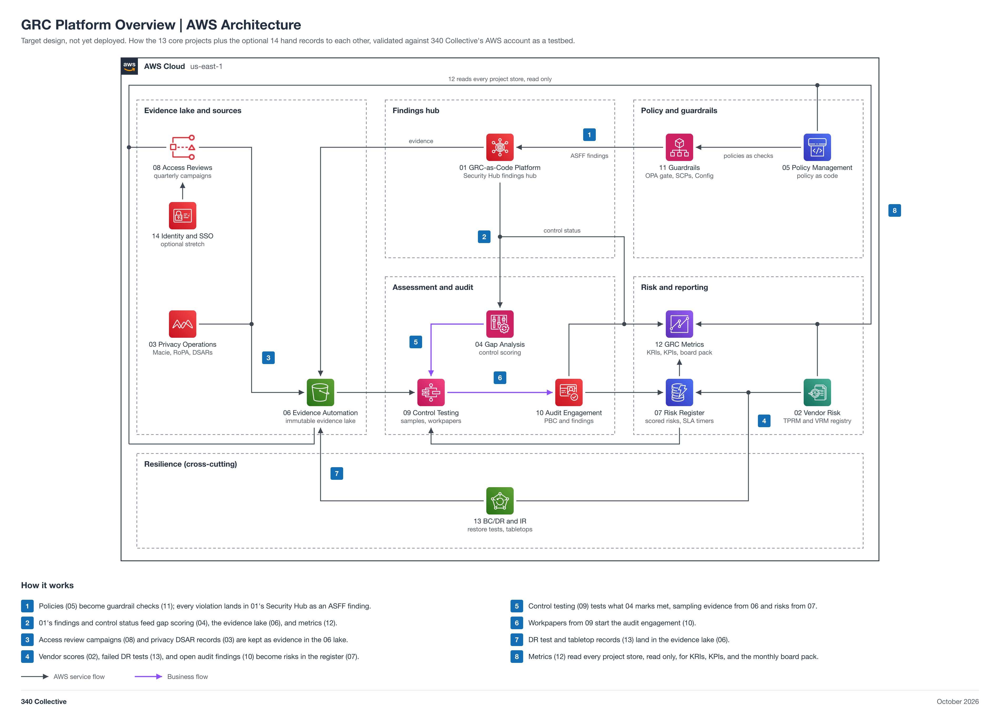

# GRC Platform Overview

A system-of-systems map of the 13 core projects in this repo, plus the optional 14 stretch. Each box is one project; each line is a record one project hands to another, traced to that project's own architecture doc or README. It shows how the set works as one GRC platform: policies become guardrails, guardrail and posture findings land in one Security Hub hub, evidence and risks collect in shared stores, assessment and audit read from those stores, and metrics read all of them.

Status: target design, not yet deployed. Like every project here, it is a reference architecture validated against 340 Collective's AWS account as a testbed.



## How the projects connect

- 01 is the findings hub. Security Hub holds every finding in ASFF, and 04, 06, and 12 read its findings and control status.
- 05 policies become 11 guardrail checks, and every guardrail violation becomes an ASFF finding in 01.
- 06 is the shared evidence lake. 08 access review campaigns, 03 DSAR records, and 13 DR test and tabletop records land there.
- 07 is the shared risk register. 02 high tier vendors, 13 failed DR tests, and 10 open audit findings become risks.
- 04, 09, and 10 are the assessment path: 09 tests the controls 04 marks met, samples from 06 and 07, and its workpapers start the 10 engagement.
- 12 reads the stores of 01, 02, 05, 06, 07, 08, and 10, read only, for KRIs, KPIs, and the board pack.
- 14 Identity and SSO (optional stretch) federates the [access model](../access-model/README.md) through Okta, and its group export becomes 08's identity source. It is drawn beside 08 with one line into it.

## Also documented, not drawn

These pairings appear in project READMEs. Drawing them would force line crossings, so they are listed here instead: 05, 08, 02, 11, and 06 feed gap scoring in 04; 05 attestations and closed 10 engagements are also evidence in 06; and auditors in 10 request 13 records as PBC items.

## Files

| File | What it is |
| --- | --- |
| [diagram/grc-platform-overview.png](diagram/grc-platform-overview.png) | Overview diagram (PNG, 2x) |
| [diagram/grc-platform-overview.svg](diagram/grc-platform-overview.svg) | Same diagram as a scalable SVG |
| [diagram/build_diagram.py](diagram/build_diagram.py) | Script that regenerates the diagram and runs its layout and sensitive-text checks |

## Regenerate the diagram

```bash
python3 diagram/build_diagram.py --setup          # once: venv + diagrams==0.25.1 (needs rsvg-convert from librsvg)
python3 diagram/build_diagram.py diagram/grc-platform-overview
```

The script must print `crossings: 0`, `layout problems: none`, and `sensitive text: none`.

## Notes

- Each project is drawn as the one AWS service at the center of its design, so the icon stands for the whole project.
- Where several projects feed one store, their lines merge at a junction dot and share the last segment into it.
- Connections show design intent. Nothing is deployed yet, so no line is verified from IaC.
