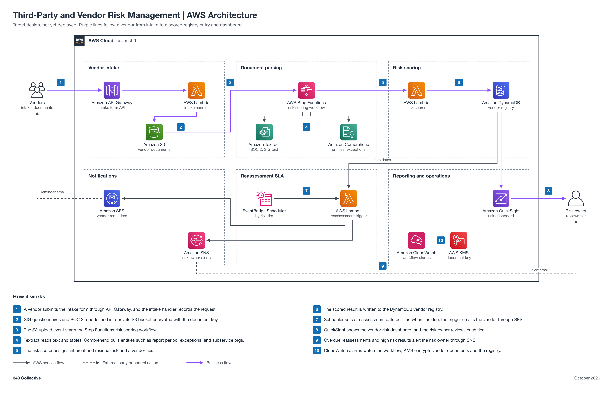

# Third-Party and Vendor Risk Management

An AWS-native third-party and vendor risk management (TPRM/VRM) pipeline. Vendors submit an intake form and their assurance documents (SIG questionnaires, SOC 2 reports), which are parsed, scored, and stored in one vendor registry with a reassessment date per risk tier. It covers SOC 2 CC9.2, ISO 27001:2022 A.5.19 to A.5.22, and NIST CSF 2.0 GV.SC. Every step from upload to scoring, reminders, and the dashboard runs without manual handoffs; the risk owner reviews the final tier.

Status: target design, not yet deployed.



## Automation moving parts

1. Vendor intake form submits through API Gateway to an intake Lambda.
2. SIG questionnaires and SOC 2 reports land in a private, KMS-encrypted S3 bucket.
3. The S3 upload event starts a Step Functions risk scoring workflow.
4. Textract extracts text and tables; Comprehend pulls entities and key phrases (report period, exceptions, subservice organizations).
5. A scoring Lambda assigns inherent and residual risk and a vendor tier.
6. The result is written to the DynamoDB vendor registry.
7. EventBridge Scheduler sets a reassessment SLA per tier, and a trigger Lambda emails the vendor through SES and alerts the risk owner through SNS.
8. QuickSight shows the vendor risk dashboard.

## 340 Collective testbed

340 Collective's real AWS infrastructure is the environment this design is validated against. The first vendors assessed are the ones 340 Collective already depends on: AWS, Stripe, the domain registrar, Google Workspace, and GitHub, using their public SOC 2 and trust center material as the sample document set. No client data, account identifiers, or resource names are published in this repo.

## Files

| File | What it is |
| --- | --- |
| [diagram/tprm-vrm-aws-architecture.png](diagram/tprm-vrm-aws-architecture.png) | Architecture diagram (PNG, 2x) |
| [diagram/tprm-vrm-aws-architecture.svg](diagram/tprm-vrm-aws-architecture.svg) | Same diagram as a scalable SVG |
| [diagram/build_diagram.py](diagram/build_diagram.py) | Script that regenerates the diagram and runs its layout and sensitive-text checks |
| [TPRM-VRM-Architecture.md](TPRM-VRM-Architecture.md) | Stage-by-stage breakdown: intake, parsing, scoring, registry, reassessment, data model, security, cost note, build order |

## Regenerate the diagram

```bash
python3 diagram/build_diagram.py --setup          # once: venv + diagrams==0.25.1 (needs rsvg-convert from librsvg)
python3 diagram/build_diagram.py diagram/tprm-vrm-aws-architecture
```

The script must print `crossings: 0`, `layout problems: none`, and `sensitive text: none`.

## Notes

- Connections show design intent. Nothing is deployed yet, so no line is verified from IaC.
- Pairs with [04 Gap Analysis](../04-gap-analysis-340collective/README.md) (vendor findings feed the third-party controls) and [07 Risk Register](../07-risk-register/README.md) (high risk vendors become register entries).
