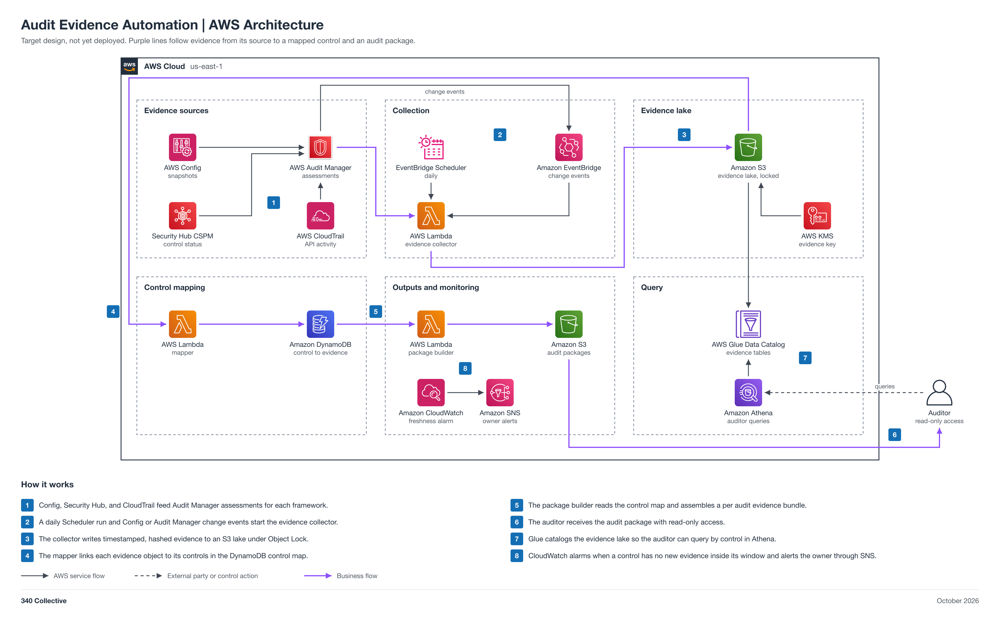

# Audit Evidence Automation

An AWS-native audit evidence pipeline. AWS Config snapshots, Audit Manager assessment evidence, and Security Hub control status are collected on a schedule and on change, written to a timestamped, hashed, Object Lock S3 evidence lake, and mapped to controls in DynamoDB. Auditors query by control through Athena and receive a per-audit evidence package. Collection, hashing, mapping, packaging, and freshness alerts are automated.

Status: target design, not yet deployed.



## Automation moving parts

1. A daily EventBridge Scheduler run, plus Config and Audit Manager change events, starts collection.
2. An evidence collector Lambda pulls Config snapshots, Audit Manager assessment evidence, and Security Hub control status.
3. It writes timestamped, hashed objects to an S3 evidence lake with Object Lock (`evidence/<framework>/<yyyy>/<mm>/<dd>/`).
4. A mapper Lambda updates the DynamoDB control-to-evidence map.
5. The Glue Data Catalog and Athena let an auditor query by control.
6. A package builder exports a per-audit evidence bundle.
7. A CloudWatch freshness alarm fires when a control has no new evidence inside its window.

## 340 Collective testbed

340 Collective's real AWS infrastructure is the environment this design is validated against. The evidence is the 340 Collective AWS account's real Config history, Security Hub results, and CloudTrail activity. No client data is collected, and no client data, account identifiers, or resource names are published in this repo.

## Files

| File | What it is |
| --- | --- |
| [diagram/evidence-automation-aws-architecture.png](diagram/evidence-automation-aws-architecture.png) | Architecture diagram (PNG, 2x) |
| [diagram/evidence-automation-aws-architecture.svg](diagram/evidence-automation-aws-architecture.svg) | Same diagram as a scalable SVG |
| [diagram/build_diagram.py](diagram/build_diagram.py) | Script that regenerates the diagram and runs its layout and sensitive-text checks |
| [Evidence-Automation-Architecture.md](Evidence-Automation-Architecture.md) | Stage-by-stage breakdown: evidence sources, collection, evidence lake, control mapping, query, packages, data model, security, cost note, build order |

## Regenerate the diagram

```bash
python3 diagram/build_diagram.py --setup          # once: venv + diagrams==0.25.1 (needs rsvg-convert from librsvg)
python3 diagram/build_diagram.py diagram/evidence-automation-aws-architecture
```

The script must print `crossings: 0`, `layout problems: none`, and `sensitive text: none`.

## Notes

- The diagram icon package has no Audit Manager icon, so the generic AWS security and compliance icon stands in for it, as in 01.
- Connections show design intent. Nothing is deployed yet, so no line is verified from IaC.
- Pairs with [01 GRC-as-Code Platform](../01-grc-as-code-platform/README.md) (consumes its Security Hub and Audit Manager output) and [04 Gap Analysis](../04-gap-analysis-340collective/README.md) (evidence status feeds gap scoring).
