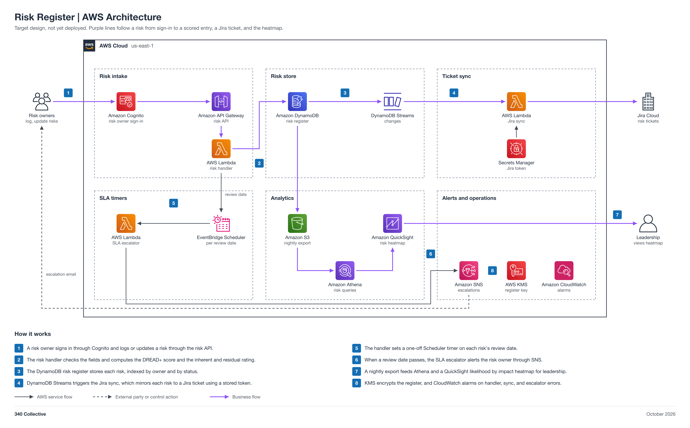

# Risk Register

An AWS-native risk register. Risk owners sign in through Cognito and log or update risks through an API, a handler scores each risk with the owner's DREAD+ model, the register lives in DynamoDB, each risk is mirrored to a Jira ticket, and every review date is a real timer that escalates when missed. It supports ISO 27001:2022 clauses 6.1 and 8.2, NIST CSF 2.0 GV.RM and ID.RA, and SOC 2 CC3. Scoring, ticket sync, SLA timers, escalation, and the heatmap are automated.

Status: target design, not yet deployed.



## Automation moving parts

1. A risk owner signs in through Cognito and submits or updates a risk through API Gateway.
2. A risk handler Lambda validates fields and computes the DREAD+ score and the inherent and residual rating.
3. The DynamoDB risk register stores each risk, with GSIs by owner and by status.
4. DynamoDB Streams triggers a sync Lambda that mirrors each risk to a Jira ticket.
5. The handler creates or updates a one-off EventBridge Scheduler schedule per risk review date (the SLA timer).
6. At expiry, an SLA escalator Lambda escalates through SNS.
7. A nightly export to S3 feeds Athena and a QuickSight likelihood by impact heatmap.

## 340 Collective testbed

340 Collective's real AWS infrastructure is the environment this design is validated against. The first register is 340 Collective's own, covering business, security, and vendor risks. No client data, account identifiers, or resource names are published in this repo.

## Files

| File | What it is |
| --- | --- |
| [diagram/risk-register-aws-architecture.png](diagram/risk-register-aws-architecture.png) | Architecture diagram (PNG, 2x) |
| [diagram/risk-register-aws-architecture.svg](diagram/risk-register-aws-architecture.svg) | Same diagram as a scalable SVG |
| [diagram/build_diagram.py](diagram/build_diagram.py) | Script that regenerates the diagram and runs its layout and sensitive-text checks |
| [Risk-Register-Architecture.md](Risk-Register-Architecture.md) | Stage-by-stage breakdown: intake, scoring, register, Jira sync, SLA timers, analytics, data model, security, cost note, build order |
| [LAB-STEPS.md](LAB-STEPS.md) | Build playbook: manual lab steps for the collaboration team |

## Regenerate the diagram

```bash
python3 diagram/build_diagram.py --setup          # once: venv + diagrams==0.25.1 (needs rsvg-convert from librsvg)
python3 diagram/build_diagram.py diagram/risk-register-aws-architecture
```

The script must print `crossings: 0`, `layout problems: none`, and `sensitive text: none`.

## Notes

- The DREAD+ scoring model and the Jira risk ticket schema are the owner's own and are kept in the owner's private notes. They are referenced here by concept only and are not copied into this repo; field names stay generic.
- The risk API sits behind a Cognito user pool authorizer, so the write API is never unauthenticated.
- Jira Cloud has no icon in the diagram package, so the generic office building icon stands in for it, as in 01.
- Connections show design intent. Nothing is deployed yet, so no line is verified from IaC.
- Pairs with [02 TPRM/VRM](../02-tprm-vrm/README.md) (high risk vendors become register entries) and [01 GRC-as-Code Platform](../01-grc-as-code-platform/README.md) (same Jira project pattern).
