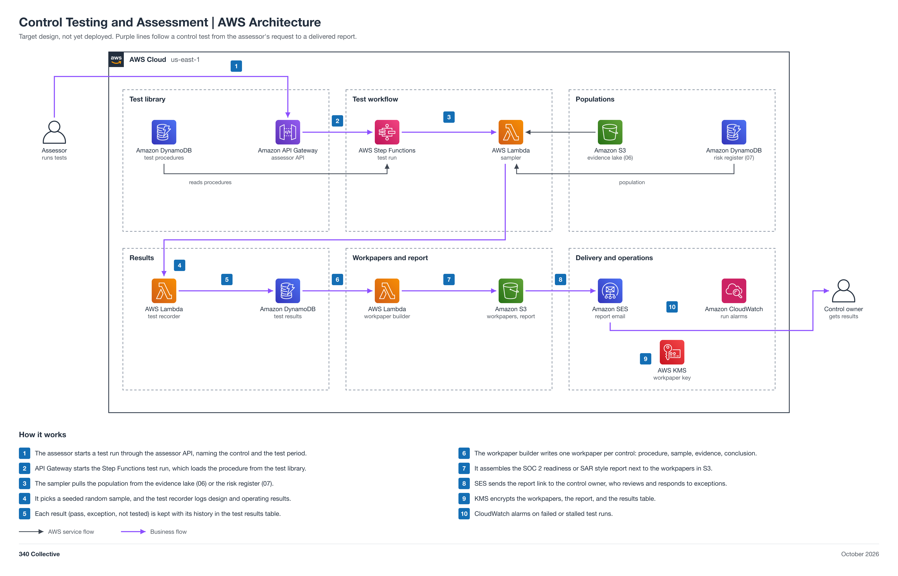

# Control Testing and Assessment

An AWS-native control testing workbench for an internal assessor. A library of controls and test procedures drives a Step Functions test run that pulls a population, picks a reproducible sample, records test of design and test of operating effectiveness results with their history, writes one workpaper per control, and assembles a SOC 2 readiness report or a NIST SP 800-53A style Security Assessment Report (SAR). Sampling, result recording, workpapers, report assembly, and delivery are automated; the assessor signs off every conclusion, and the control owner responds to every exception.

Status: target design, not yet deployed.



## Automation moving parts

1. A DynamoDB library holds controls and test procedures: procedure steps, population source, and a sample size rule by control frequency.
2. The assessor starts a test run through API Gateway, which starts a Step Functions test workflow.
3. A sampling Lambda pulls the population (for example from the 06 evidence lake or the 07 risk register) and picks a reproducible random sample with a recorded seed.
4. A test recorder Lambda records design and operating results (pass, exception, not tested) in a DynamoDB results table that keeps every prior result as history.
5. A workpaper Lambda writes one workpaper per control to S3: procedure, sample, evidence references, and conclusion.
6. A report builder step assembles the SOC 2 readiness or SAR style report to S3.
7. SES notifies the control owner that the report and any exceptions are ready.

## 340 Collective testbed

340 Collective's real AWS infrastructure is the environment this design is validated against. The first assessment covers 340 Collective's own controls, starting with the controls that [04 Gap Analysis](../04-gap-analysis-340collective/README.md) marks met, and samples from its real evidence lake and risk register. No client data, account identifiers, or resource names are published in this repo.

## Files

| File | What it is |
| --- | --- |
| [diagram/control-testing-aws-architecture.png](diagram/control-testing-aws-architecture.png) | Architecture diagram (PNG, 2x) |
| [diagram/control-testing-aws-architecture.svg](diagram/control-testing-aws-architecture.svg) | Same diagram as a scalable SVG |
| [diagram/build_diagram.py](diagram/build_diagram.py) | Script that regenerates the diagram and runs its layout and sensitive-text checks |
| [Control-Testing-Architecture.md](Control-Testing-Architecture.md) | Stage-by-stage breakdown: test library, test workflow, results, workpapers and report, delivery, data model, security, cost note, build order |

## Regenerate the diagram

```bash
python3 diagram/build_diagram.py --setup          # once: venv + diagrams==0.25.1 (needs rsvg-convert from librsvg)
python3 diagram/build_diagram.py diagram/control-testing-aws-architecture
```

The script must print `crossings: 0`, `layout problems: none`, and `sensitive text: none`.

## Notes

- Approvers: the assessor signs off each workpaper conclusion before it enters the report, and the 340 Collective owner, as control owner, accepts or remediates each exception.
- The assessor API sits behind an authorizer (Cognito or IAM), so test runs cannot be started anonymously.
- The report is a readiness or internal assessment report. It is not a SOC 2 attestation, which only an independent CPA firm can issue.
- Connections show design intent. Nothing is deployed yet, so no line is verified from IaC.
- Pairs with [06 Evidence Automation](../06-evidence-automation/README.md) and [07 Risk Register](../07-risk-register/README.md) (sample populations), [04 Gap Analysis](../04-gap-analysis-340collective/README.md) (which controls to test), and [10 Audit Engagement Manager](../10-audit-engagement-manager/README.md) (workpapers become the auditor's input).
