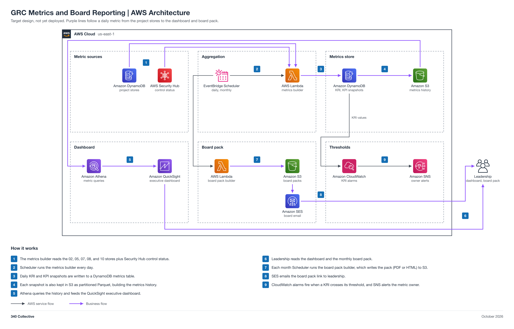

# GRC Metrics and Board Reporting

An AWS-native metrics layer for the GRC analyst and for leadership. A daily job reads the stores of the other projects and Security Hub, computes key risk indicators (KRIs) and key performance indicators (KPIs), keeps a daily history, feeds a QuickSight executive dashboard, and builds a monthly board pack that is emailed to leadership. It supports ISO 27001:2022 clause 9.1 (monitoring, measurement, analysis, and evaluation) and clause 9.3 (management review), NIST CSF 2.0 GV.OV, and SOC 2 CC4.1. Collection, calculation, history, the dashboard, the board pack, and threshold alerts are automated; the 340 Collective owner approves each board pack before it is sent.

Status: target design, not yet deployed.



## Example metrics

- KRIs: open high risks, overdue findings, vendors past reassessment, and unreviewed access.
- KPIs: control pass rate, mean time to remediate, policy attestation rate, and evidence freshness.

## Automation moving parts

1. A daily EventBridge Scheduler run starts the metrics builder Lambda.
2. It reads the DynamoDB stores of 02, 05, 07, 08, and 10, plus Security Hub control status.
3. It writes daily snapshots to a DynamoDB metrics table and to S3 as Parquet.
4. Athena feeds the QuickSight executive dashboard.
5. A monthly cron builds the board pack (PDF or HTML) to S3, and SES emails it to leadership.
6. A CloudWatch alarm fires on KRI threshold breaches and alerts the metric owner through SNS.

## 340 Collective testbed

340 Collective's real AWS infrastructure is the environment this design is validated against. The metrics are 340 Collective's real posture: its own risks, vendors, policies, access reviews, findings, and Security Hub control status. No client data, account identifiers, or resource names are published in this repo.

## Files

| File | What it is |
| --- | --- |
| [diagram/grc-metrics-aws-architecture.png](diagram/grc-metrics-aws-architecture.png) | Architecture diagram (PNG, 2x) |
| [diagram/grc-metrics-aws-architecture.svg](diagram/grc-metrics-aws-architecture.svg) | Same diagram as a scalable SVG |
| [diagram/build_diagram.py](diagram/build_diagram.py) | Script that regenerates the diagram and runs its layout and sensitive-text checks |
| [GRC-Metrics-Architecture.md](GRC-Metrics-Architecture.md) | Stage-by-stage breakdown: metric sources, aggregation, metrics store, dashboard, board pack, thresholds, data model, security, cost note, build order |
| [LAB-STEPS.md](LAB-STEPS.md) | Build playbook: manual lab steps for the collaboration team |

## Regenerate the diagram

```bash
python3 diagram/build_diagram.py --setup          # once: venv + diagrams==0.25.1 (needs rsvg-convert from librsvg)
python3 diagram/build_diagram.py diagram/grc-metrics-aws-architecture
```

The script must print `crossings: 0`, `layout problems: none`, and `sensitive text: none`.

## Notes

- Approvers: the 340 Collective owner approves each monthly board pack before SES sends it, and approves every change to a KRI threshold. Each metric has a named metric owner who receives its threshold alerts.
- The single "project stores" DynamoDB icon stands for the read-only reads of the 02, 05, 07, 08, and 10 tables.
- Connections show design intent. Nothing is deployed yet, so no line is verified from IaC.
- Build this last: it reads every other project's store. Pairs with [07 Risk Register](../07-risk-register/README.md), [10 Audit Engagement Manager](../10-audit-engagement-manager/README.md), and [01 GRC-as-Code Platform](../01-grc-as-code-platform/README.md) (Security Hub control status).
