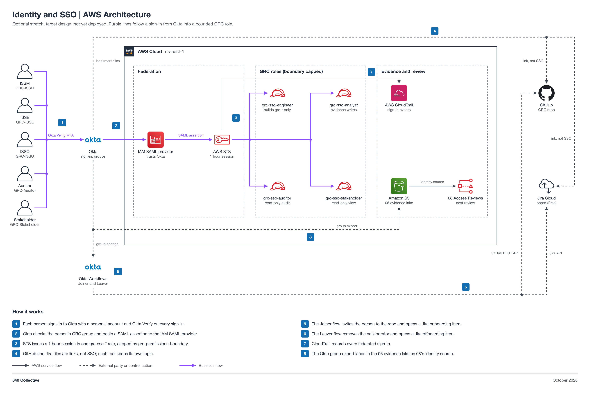

# Identity and SSO

Okta in front of 340 Collective's AWS account for the GRC team. People sign in to an Okta Integrator Free Plan org with their personal email and Okta Verify, and Okta federates them through a direct IAM SAML provider into one of four GRC roles capped by the access model's permissions boundary. GitHub and Jira are Okta bookmark tiles (link, not SSO), recorded as a deviation. Two Okta Workflows handle joiners and leavers, and the Okta group export becomes the identity source for 08 Access Reviews. It supports SOC 2 CC6.1 to CC6.3, ISO 27001:2022 A.5.15 to A.5.18 and A.8.5, and NIST CSF 2.0 PR.AA.

Status: target design, not yet deployed. Optional stretch: about 2 weeks, 0 dollars, built after 01, 11, 06, and 07 are moving and before the next 08 review. Skip it if nobody wants it.

Owner: Adam (ISSO). Independent validator and approver: Faris (ISSM). Assignments can be swapped with ISSM agreement.

Jira: GRC-15



## Automation moving parts

1. Each person signs in to Okta with Okta Verify on every sign-in. Okta groups are by function: GRC-ISSM, GRC-ISSE, GRC-ISSO, GRC-Auditor, GRC-Stakeholder.
2. Okta checks the group and posts a SAML assertion to the IAM SAML provider.
3. STS issues a 1 hour session in one of `grc-sso-engineer`, `grc-sso-analyst`, `grc-sso-auditor`, or `grc-sso-stakeholder`, each capped by `grc-permissions-boundary`.
4. Bookmark tiles link to the GRC-Projects repo, its open pull requests, and the Jira GRC board. Each tool keeps its own login.
5. The Joiner flow invites a new group member as a GitHub collaborator and opens a Jira onboarding work item.
6. The Leaver flow removes the collaborator and opens a Jira offboarding work item with a checklist.
7. CloudTrail records every `AssumeRoleWithSAML` sign-in.
8. The Okta group export lands in the 06 evidence lake as 08's identity source.

## 340 Collective testbed

340 Collective's real AWS account is the federation target. Validation is one sign-in per role from the Okta tile, a denied write as the auditor role, and a full join and leave of a test user across AWS, GitHub, and Jira. No account identifiers, email addresses, or tokens are published in this repo.

## Files

| File | What it is |
| --- | --- |
| [diagram/identity-sso-aws-architecture.png](diagram/identity-sso-aws-architecture.png) | Architecture diagram (PNG, 2x) |
| [diagram/identity-sso-aws-architecture.svg](diagram/identity-sso-aws-architecture.svg) | Same diagram as a scalable SVG |
| [diagram/build_diagram.py](diagram/build_diagram.py) | Script that regenerates the diagram and runs its layout and sensitive-text checks |
| [Identity-SSO-Architecture.md](Identity-SSO-Architecture.md) | Layer-by-layer breakdown: Identity Center versus direct SAML, roles, tile versus SSO per tool, workflow designs, risks, cost, evidence, teardown |
| [LAB-STEPS.md](LAB-STEPS.md) | Build playbook: manual lab steps for the collaboration team |

## Regenerate the diagram

```bash
python3 diagram/build_diagram.py --setup          # once: venv + diagrams==0.25.1 (needs rsvg-convert from librsvg)
python3 diagram/build_diagram.py diagram/identity-sso-aws-architecture
```

The script must print `crossings: 0`, `layout problems: none`, and `sensitive text: none`.

## Notes

- Bookmark tiles are links, not SSO. Real GitHub and Jira SSO needs GitHub Enterprise Cloud and Atlassian Guard on a verified domain, which personal email accounts cannot meet. See the deviation request in the architecture doc.
- MFA is enforced in Okta, because SAML federation does not set `aws:MultiFactorAuthPresent`.
- The access model stays the source of truth for policies. The ISSM deploys the SAML provider and roles stack; the engineer policy cannot create SAML providers.
- Connections show design intent. Nothing is deployed yet, so no line is verified from IaC.
- Pairs with the [access model](../access-model/README.md) (policies and boundary) and [08 Access Reviews](../08-access-reviews/README.md) (the Okta group export is its identity source).
