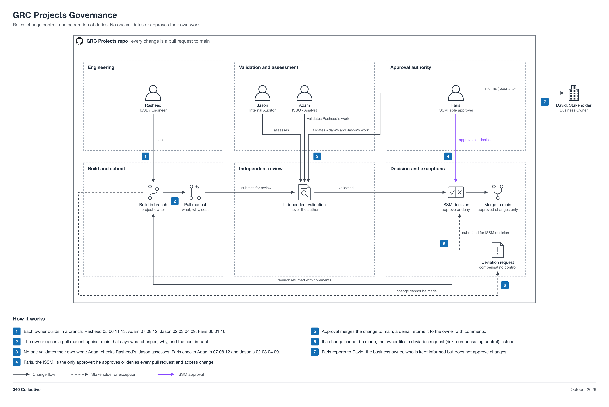

# Governance

How this collaboration runs. This repo is a GRC engineering portfolio built by a small team, using 340 Collective's AWS account as a shared testbed. It is a learning project, not a business need. The goal is real hands-on experience that holds up on a resume, produced under the same discipline a regulated program would use.

Status: this document is the operating manual. The project folders (00 to 14, where 14 is an optional stretch) are target designs, not yet deployed.

The diagram above maps the roles and how a change moves from the owner through an independent validator to ISSM approval and merge, with the deviation path when a change cannot be made. The diagram sources are in [governance-diagram/](governance-diagram/) as PNG and SVG, with `grc-governance_build.py` to regenerate them.

The shared control reference for every project is the [ASFF control matrix](01-grc-as-code-platform/ASFF-Control-Matrix-Indexed.xlsx). Map findings, evidence, risks, and deviation requests to its ASFF `SecurityControlId` values so the whole program speaks one control language. Changes to the matrix follow the change process below, like any other change. It is maintained in [01 GRC-as-Code Platform](01-grc-as-code-platform/README.md).

## Principles

- Build it as code. Infrastructure is created only through CloudFormation. Anything created by hand in the console is deleted.
- Keep it cheap. Total AWS spend stays under 10 dollars per month across the whole project, and 0 dollars is the target. Build, capture evidence, then tear it down.
- Nobody signs off on their own work. Separation of duties is enforced through roles and pull request approval.
- Change is controlled. Every change is a pull request the ISSM approves. If a needed change cannot be made, it goes through a deviation request.
- Do not make an expensive mess. Check service quotas and limits before building. If a service is not free, confirm the cost before enabling it.

## Roles

| Person | Role | Responsibility |
| --- | --- | --- |
| David | Business Owner / Stakeholder | Owns 340 Collective and its AWS account. Faris reports to David as the stakeholder. David does not approve pull requests or changes. |
| Faris | ISSM / Architect (Program Lead) | Owns governance and holds all approve and deny authority. Approves or denies every pull request and every access change, and is the final validator for work that has no other independent validator. |
| Rasheed | ISSE / Engineer | Implements infrastructure, fixes vulnerabilities, documents changes, builds automation. |
| Jason | Auditor / Assessor | Independent white-box review and assessment. Does not implement what he assesses. |
| Adam | ISSO / Analyst | Validates engineer work, reports on vulnerabilities, prioritizes, writes reports, makes recommendations. |
| To be onboarded | IAM / Identity Engineer | Owns the Okta sign-in launch point and lifecycle automation (project 14). Builds in a branch like everyone else. |

## Project assignments

Each core team member owns 3 to 4 projects; the IAM Engineer, once onboarded, owns the optional 14. Assignments reflect interests and can be swapped with ISSM agreement.

| Owner | Projects |
| --- | --- |
| Faris (ISSM) | 00 Platform Overview, 01 GRC-as-Code Platform, 10 Audit Engagement Manager |
| Rasheed (ISSE) | 05 Policy Management, 06 Evidence Automation, 11 Guardrails, 13 BC/DR and IR |
| Adam (ISSO) | 07 Risk Register, 08 Access Reviews, 12 Metrics and Reporting |
| Jason (Auditor) | 02 TPRM/VRM, 03 Privacy, 04 Gap Analysis, 09 Control Testing |
| IAM Engineer (to be onboarded) | 14 Identity and Access (Okta) (stretch) |

Optional stretches:

- [14 Identity and Access (Okta)](14-identity-access/README.md) (IAM Engineer, to be onboarded): Okta as the sign-in launch point for AWS, GitHub, and Jira through the Okta Browser Plugin (no SSO), with joiner and leaver flows. About 2 weeks, 0 dollars. It waits until the IAM Engineer is onboarded and has access through the access model. Skip it if nobody wants it.
- Adam's stretch: a Splunk instance ingesting an EC2 instance for continuous-monitoring dashboards.

Treat both as learning extras and watch their cost (see Cost guardrails).

## Separation of duties

The rule is that no one validates or approves their own work. The chain:

1. The owner builds the project in a branch and opens a pull request.
2. An independent validator reviews it. For engineer-built work (Rasheed), Adam validates. For assessment work, Jason assesses independently.
3. The ISSM (Faris) approves or denies the pull request. Nothing merges to `main` without ISSM approval.
4. For Adam's own build projects (07, 08, 12), the ISSM is the independent validator, since the usual validator is the author. This closes the gap where the validator would otherwise have no validator.
5. For project 14 (IAM Engineer), the ISSO (Adam) is the independent validator, since 14 feeds his 08 access reviews, and the ISSM approves.

## Change process

Modeled on a FedRAMP-style change workflow.

1. Open a change by creating a branch and a pull request against `main`. Describe what changes, why, and the expected cost impact.
2. The independent validator reviews.
3. The ISSM approves or denies. Approval merges; denial returns it with comments.
4. If a change is needed but cannot be made (a quota block, a cost ceiling, a missing dependency), file a deviation request instead of forcing the change.

### Deviation request

When you cannot make a required change, document it so the gap is tracked rather than hidden. Include:

- What was required and why it cannot be done now.
- The risk or control affected.
- The workaround or compensating control in place.
- The target date to revisit.

## Cost guardrails

The project runs at or near 0 dollars. These are the rules and the watch list that keep it there.

- Every account gets an AWS Budget of 10 dollars with alerts at 1, 5, and 10 dollars, defined in CloudFormation.
- Build, capture evidence with screenshots, then deprecate. Tearing the stack down after evidence is captured is a required step, not optional.
- Check service quotas and limits before building anything.

Services that can break the budget if left running. Confirm cost before enabling:

- QuickSight (used by 07 and 12 designs): not covered by the usual free tier. Standard authors run about 9 to 12 dollars per user per month, which alone can exceed the whole budget. For a 0 dollar target, use CloudWatch dashboards or a static export instead.
- Macie (03): free trial, then charges per gigabyte scanned. Keep to the trial or sample data.
- Audit Manager (06): charges per assessment. Enable only while capturing evidence, then disable.
- Config, GuardDuty, Inspector, Security Hub (01, 06, 11): free tiers that expire, usually after 30 days, then charge per item. Watch the clock and tear down.
- Splunk plus EC2 (Adam's stretch): Splunk Free caps at 500 MB per day, and the EC2 host is only free inside the 12-month free tier. The easiest way to overshoot 10 dollars.
- Okta (14): the Integrator Free Plan is 0 dollars but is meant for development and testing. It caps at 10 active users and 5 Workflows, and the org deactivates if nobody signs in for 90 consecutive days. Single sign-on into GitHub needs GitHub Enterprise Cloud and into Jira needs Atlassian Guard, both paid per user per month, which would break the budget. 14 does not use single sign-on: the Okta Browser Plugin fills each tool's own sign-in, and each tool keeps its own MFA.

## Access to the real environment

Access to 340 Collective's AWS account is granted only after the accounts exist and only through least-privilege IAM defined in CloudFormation. Access is not granted by hand.

- Roles are defined as code, scoped to what each role needs: engineer (build and deploy stacks), auditor (read-only assessment), analyst (read plus evidence export).
- The ISSM approves the access template as a pull request like any other change. David is kept informed as the stakeholder but is not an approver.
- No personal credentials or email addresses are stored in this repo or baked into templates. Roles are referenced by function, not by person.

The access model is defined in [access-model/grc-access.yaml](access-model/grc-access.yaml). [access-model/README.md](access-model/README.md) explains what each role can and cannot do, how the template is deployed, and how it is validated.

## Future ideas

Not current state. These are directions the project could grow into later, written down so the intent is captured and nobody treats them as already in place. None of this is built, and none of it is required to finish the portfolio.

### Single sign-on with Okta

Today access is per-tool: each person signs in to AWS, GitHub, and Jira separately. A future version could put an identity provider in front of everything so one login governs them all, which is how a real regulated program runs identity.

- Okta as the identity provider, with every tool (AWS, GitHub, Jira, Google Workspace, Slack) eventually connected through SAML or OIDC single sign-on. Only the sign-in launch point is designed today, in project 14, and it does not use single sign-on.
- Joiners, movers, and leavers handled in one place. Granting or revoking a person updates every connected tool at once, instead of touching each tool by hand.
- Group-based access that maps to the roles already defined above (ISSM, ISSE, auditor, analyst), so least privilege is enforced by group membership rather than per-tool settings.
- Multi-factor authentication enforced centrally, which gives 08 Access Reviews a single authoritative source to review against.

The launch point is now designed as [14 Identity and Access (Okta)](14-identity-access/README.md), an optional stretch on Okta's free plan: people sign in to Okta with MFA, the Okta Browser Plugin fills the sign-in for the AWS console (the access model's IAM users), GitHub, and Jira while each tool keeps its own MFA, and two flows handle joiners and leavers. Not using single sign-on is recorded as a deviation. Full single sign-on across AWS, GitHub, Jira, Google Workspace, and Slack stays a future idea. It is gated on a shared domain and paid tiers (GitHub Enterprise Cloud, Atlassian Guard), and would be weighed against the 10 dollar cost ceiling before anyone builds it.

### Enterprise tool stack

The longer-term picture is a connected toolset rather than separate accounts, each playing the part it would in a real program:

- AWS: the environment under governance.
- Okta: sign-in launch point for AWS, GitHub, and Jira (designed in 14), single sign-on across every tool later.
- Google Workspace: documents, mail, and shared drives.
- GitHub: infrastructure as code and change control.
- Slack: team communication and alert routing.
- Jira: project and work tracking (in use today).
- Splunk: log aggregation and continuous-monitoring dashboards (Adam's stretch today, central later).

The value is the connections between them: Okta fronting access, GitHub driving change, Jira tracking the work, Splunk watching the environment. Each piece is adopted only when it earns its place and fits the cost ceiling.

## Build order

Recommended order, from the root README: 01, 11, 06, 04, 09, 05, 07, 08, 10, 13, 02, 03, 12, with 14 as an optional stretch after 01 and the access model and before the next 08 review. Detect and prevent first, then evidence and assessment, then governance records, then audit and resilience, then the heavier ML and PII services, and metrics last because 12 reads every other store.

### Who builds what, and in what order

This is the single sequence for the whole team, so there is no confusion about whose turn it is and what each project waits on. Work the steps top to bottom. A project can start once the projects it depends on are far enough along to hand off the record it needs. Dependencies are drawn in [00 Platform Overview](00-platform-overview/README.md).

| Step | Project | Owner | Starts after | Why this order |
| --- | --- | --- | --- | --- |
| 1 | 01 GRC-as-Code Platform | Faris | nothing (start here) | Security Hub is the findings hub everything else reads. |
| 2 | 11 Guardrails | Rasheed | 01 | Guardrail violations become findings in 01, so 01 exists first. |
| 3 | 06 Evidence Automation | Rasheed | 01 | The shared evidence lake. 03, 08, and 13 land records here later. |
| 4 | 04 Gap Analysis | Jason | 01, 06 | Reads 01 findings and 06 evidence to score control coverage. |
| 5 | 09 Control Testing | Jason | 04, 06 | Tests the controls 04 marks met and samples from 06. |
| 6 | 05 Policy Management | Rasheed | 01 | Policies become 11 guardrail checks and 06 evidence. |
| 7 | 07 Risk Register | Adam | 01 | The shared risk store. 02, 13, and 10 feed risks into it later. |
| 8 | 08 Access Reviews | Adam | 06 | Access review campaigns land as evidence in 06. |
| 9 | 10 Audit Engagement Manager | Faris | 09, 07 | Runs the engagement off 09 workpapers and 07 risks. |
| 10 | 13 BC/DR and IR | Rasheed | 06, 07 | DR and tabletop records land in 06; failed tests become 07 risks. |
| 11 | 02 TPRM/VRM | Jason | 07 | High tier vendors become risks in 07. |
| 12 | 03 Privacy | Jason | 06 | DSAR records land as evidence in 06. |
| 13 | 12 Metrics and Reporting | Adam | all of the above | Reads every other store, so it is built last. |
| 14 | 14 Identity and Access (Okta) (optional stretch) | IAM Engineer (to be onboarded) | 01 and the access model, and the IAM Engineer onboarded with access through the access model; before the next 08 review | Optional stretch. Puts Okta in front of the access model's IAM users and feeds 08's identity source. |

### Each person's own queue

- Faris (ISSM): 01, then 10. Build 01 first since the whole set depends on it, then 10 once 09 and 07 are ready.
- Rasheed (ISSE): 11, 06, 05, 13. Start after 01 exists. 06 before 05 so the evidence lake is ready; 13 last since it needs 06 and 07.
- Adam (ISSO): 07, 08, 12. 07 first (other projects feed it), 08 after 06 exists, 12 last since it reads every store.
- Jason (Auditor): 04, 09, 02, 03. 04 and 09 are the assessment path and come earlier; 02 and 03 follow once 07 and 06 are ready.
- IAM Engineer (to be onboarded): 14, optional. Starts only after onboarding and access through the access model, after 01 and the access model, and before the next 08 review. Adam validates; the ISSM approves.

No one is blocked waiting for the whole set. Once 01 is up, Rasheed, Adam, and Jason can each start their first project in parallel, since 11, 07, and 04 all depend only on 01 (04 also wants 06, which Rasheed builds early)

## Timeline

The project runs 3 to 6 months. Put a project on your resume only after you complete your section. The more sections you complete, the more experience you earn.
