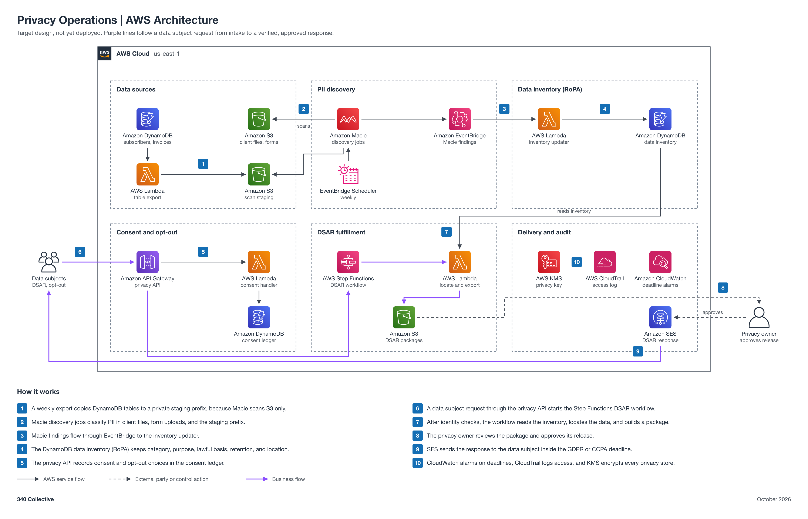

# Privacy Operations

| Field | Value |
| --- | --- |
| Project | 03 Privacy Operations |
| Your role | Alex (Security Automation Engineer), engineer: you design, deploy, test, hand off, and tear down |
| Your partner | Jason (Internal Auditor) |
| Reviewer or validator | Code review: Rasheed or Maria. Acceptance test: Jason (Internal Auditor), a pass or findings record in Jira, not an approval. Validation: Adam (ISSO), in Jira. Final approval: Faris (ISSM). |
| Phase | Phase 2, 2 points (M) |
| Jira epic | `GRC-<NN>` (a placeholder until Faris creates the epic) |
| Mirrored folder | [non-engineering/Jason-03-Privacy](../../non-engineering/Jason-03-Privacy/README.md) |
| Lab guide | [LAB-STEPS.md](LAB-STEPS.md) for this folder, and the general guide [shared/labs/README.md](../../shared/labs/README.md) |

Your part: You build PII discovery and the DSAR workflow. Work with Jason (Internal Auditor): he gives you the RoPA fields and DSAR requirements, then runs the acceptance test on your build in Jira.

<details>
<summary>Lab steps summary</summary>

Full steps: [LAB-STEPS.md](LAB-STEPS.md). Mirror: [the other track's lab steps](../../non-engineering/Jason-03-Privacy/LAB-STEPS.md).

- Design: 5 steps
- Deploy: 4 steps
- Test: 3 steps
- Hand off: 3 steps
- Tear down: 5 steps

</details>

<details>
<summary>Handoffs</summary>

- Handoff 1: RoPA fields, PII inventory, and DSAR runbook requirements, Jason to Alex (Jira Task, created by Jason)
- Handoff 2: PII discovery and DSAR workflow ready for acceptance testing, Alex to Jason (Jira Task, created by Alex)
- Handoff 3: synthetic DSAR walkthrough and consent register, Jason to Faris (Jira Task, created by Jason)

</details>

<details>
<summary>Jira</summary>

- Epic: `GRC-<NN>` (a placeholder until Faris creates the epic).
- Each numbered handoff is a Jira Task linked to the epic, created by the person who sends it.
- Partner acceptance and Adam's validation are recorded on the Task. A pull request in this repo links its Task on the Jira issue line and merges only after the Task shows acceptance.

</details>

<details>
<summary>Cost</summary>

Macie would be the main cost; with synthetic records and a scoped Lambda the rest stays at or near the free tier.

The program cap is 10 dollars a month for the whole account, with budget alerts at 1, 5, and 10 dollars.

</details>

<details>
<summary>Teardown</summary>

- Tear down after acceptance, validation, and final approval are on the Jira Task, before the phase ends.
- Empty every `grc-*` bucket the stack created, including all object versions and delete markers.
- Delete the `grc-privacy` stack from clean `main` and wait for `DELETE_COMPLETE`.
- If an access-change PR let you turn on Macie, turn it off now.
- Record teardown evidence (stack deleted, buckets gone, services off, spend under the 1 dollar alert) where the ISSM designates, outside git, and note it on the Jira epic.

</details>

<details>
<summary>Frameworks covered</summary>

GDPR, CCPA, and CPRA privacy operations (RoPA, DSAR, consent).

</details>

An AWS-native privacy operations design for GDPR, CCPA, and CPRA. Amazon Macie discovers personal data, an inventory Lambda keeps a record of processing activities (RoPA) current in DynamoDB, a consent and opt-out API records choices, and a Step Functions workflow fulfills data subject access requests (DSARs) inside the legal deadline. Discovery, inventory updates, request intake, data location, and deadline tracking are automated; the privacy owner approves every release.

Status: target design, not yet deployed.



## Automation moving parts

1. A scheduled Lambda exports DynamoDB tables to a private staging prefix in S3.
2. Macie discovery jobs classify PII in S3 (client files, form uploads, and the staging prefix).
3. Macie findings go through EventBridge to an inventory updater Lambda.
4. The DynamoDB data inventory (RoPA) holds data category, purpose, lawful basis, retention, and location.
5. The consent and opt-out API (API Gateway and Lambda) writes a consent ledger.
6. A DSAR starts a Step Functions workflow: verify identity, locate data from the inventory, assemble the package, wait for privacy owner approval, deliver.
7. SES sends the response, and a CloudWatch deadline alarm watches the GDPR (one month) and CCPA (45 days) clocks.

## 340 Collective testbed

340 Collective's real AWS infrastructure is the environment this design is validated against. The data in scope is the 340collective.com contact form submissions, newsletter subscribers, invoice records, and client files in the 340 Collective account, and every DSAR test uses synthetic test subjects only. No client data, account identifiers, or resource names are published in this repo.

## Files

| File | What it is |
| --- | --- |
| [diagram/privacy-aws-architecture.png](diagram/privacy-aws-architecture.png) | Architecture diagram (PNG, 2x) |
| [diagram/privacy-aws-architecture.svg](diagram/privacy-aws-architecture.svg) | Same diagram as a scalable SVG |
| [diagram/build_diagram.py](diagram/build_diagram.py) | Script that regenerates the diagram and runs its layout and sensitive-text checks |
| [Privacy-Architecture.md](Privacy-Architecture.md) | Stage-by-stage breakdown: data sources, PII discovery, RoPA inventory, consent, DSAR workflow, data model, security, cost note, build order |
| [LAB-STEPS.md](LAB-STEPS.md) | Engineering lab steps: design, deploy, test, hand off, tear down |
| [Partner lab steps](../../non-engineering/Jason-03-Privacy/LAB-STEPS.md) | The partner's non-engineering lab steps (reference; the partner works in Jira) |

## Regenerate the diagram

```bash
python3 diagram/build_diagram.py --setup          # once: venv + diagrams==0.25.1 (needs rsvg-convert from librsvg)
python3 diagram/build_diagram.py diagram/privacy-aws-architecture
```

The script must print `crossings: 0`, `layout problems: none`, and `sensitive text: none`.

## Notes

- Macie scans S3 only. It cannot scan RDS or DynamoDB directly, so a scheduled export Lambda writes DynamoDB items (and RDS snapshot exports, if RDS is ever added) to a private staging prefix that Macie scans. 340 Collective runs on S3 and DynamoDB today, not RDS.
- Connections show design intent. Nothing is deployed yet, so no line is verified from IaC.
- Pairs with [06 Evidence Automation](../Maria-06-Evidence-Automation/README.md) (DSAR records become privacy evidence) and [02 TPRM/VRM](../Maria-02-TPRM-VRM/README.md) (vendors that process personal data).
