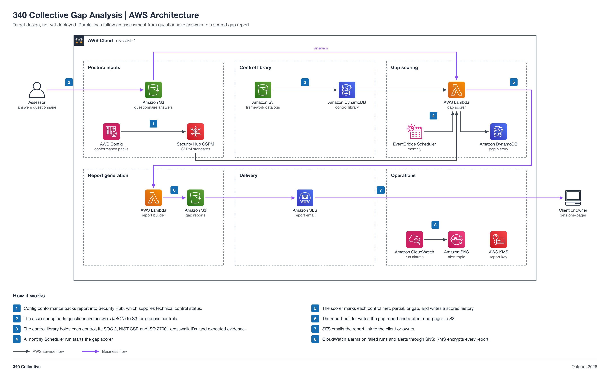

# 340 Collective Gap Analysis

A repeatable gap analysis that scores an environment against SOC 2 (2017 TSC), NIST CSF 2.0, and ISO 27001:2022 Annex A from one crosswalked control library. Technical posture comes from AWS Config and Security Hub, process controls come from assessor questionnaire answers, and a monthly scoring run produces a gap report and a client-facing one-pager. Scoring, history, report generation, and delivery are automated; the assessor supplies the answers.

Status: target design, not yet deployed.



## Automation moving parts

1. Config conformance packs and Security Hub standards supply technical posture.
2. Assessor questionnaire answers (JSON) are uploaded to S3 for process controls.
3. The DynamoDB control library holds controls, crosswalk IDs, and expected evidence.
4. A monthly EventBridge Scheduler run starts the gap scoring Lambda.
5. The scorer marks each control met, partial, or gap and writes a scored history table.
6. A report builder Lambda writes the gap report and a client-facing one-pager to S3.
7. SES emails the report link to the owner.

## 340 Collective testbed

340 Collective's real AWS infrastructure is the environment this design is validated against. 340 Collective's own security posture is the first assessed "client": its Config rules, Security Hub standards, and its own questionnaire answers produce the first scored report. No client data, account identifiers, or resource names are published in this repo.

## Files

| File | What it is |
| --- | --- |
| [diagram/gap-analysis-aws-architecture.png](diagram/gap-analysis-aws-architecture.png) | Architecture diagram (PNG, 2x) |
| [diagram/gap-analysis-aws-architecture.svg](diagram/gap-analysis-aws-architecture.svg) | Same diagram as a scalable SVG |
| [diagram/build_diagram.py](diagram/build_diagram.py) | Script that regenerates the diagram and runs its layout and sensitive-text checks |
| [Gap-Analysis-Architecture.md](Gap-Analysis-Architecture.md) | Stage-by-stage breakdown: posture inputs, control library, gap scoring, report generation, delivery, data model, security, cost note, build order |
| [LAB-STEPS.md](../../non-engineering/Jason-04-Gap-Analysis/LAB-STEPS.md) | Build playbook: manual lab steps for the collaboration team |

## Regenerate the diagram

```bash
python3 diagram/build_diagram.py --setup          # once: venv + diagrams==0.25.1 (needs rsvg-convert from librsvg)
python3 diagram/build_diagram.py diagram/gap-analysis-aws-architecture
```

The script must print `crossings: 0`, `layout problems: none`, and `sensitive text: none`.

## Notes

- The one-pager follows the 340 Collective `client-onepager-style` standard. The template itself is not copied into this repo.
- Connections show design intent. Nothing is deployed yet, so no line is verified from IaC.
- Pairs with [01 GRC-as-Code Platform](../Faris-01-GRC-as-Code-Platform/README.md) (Security Hub findings) and [06 Evidence Automation](../Maria-06-Evidence-Automation/README.md) (evidence freshness per control can feed the score).
