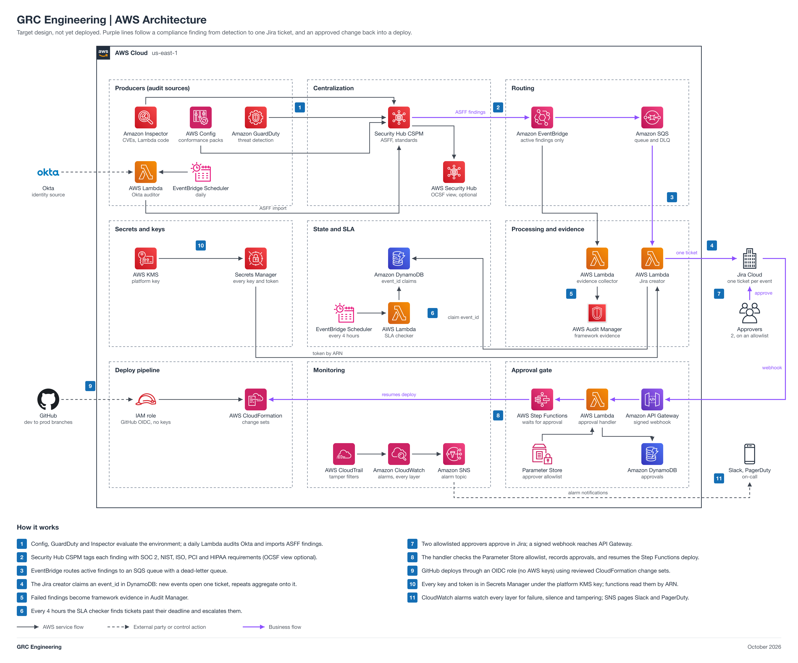

# GRC-as-Code Platform

| Field | Value |
| --- | --- |
| Project | 01 GRC-as-Code Platform |
| Your role | Faris (ISSM), engineer: you design, deploy, test, hand off, and tear down |
| Your partner | Jason (Internal Auditor) |
| Reviewer or validator | Code review: Rasheed, with Maria as backup. Acceptance and final approval: Adam, since Faris built it. Jason assesses SOC 2 coverage (Handoff 4), not an approval. |
| Phase | Foundation in Phase 1 (3 points, L); 01 platform in Phase 2 (2 points, M) |
| Week | Foundation: Week 1, Oct 19 to 25, 2026; 01 platform: Week 2, Oct 26 to Nov 1, 2026 |
| Jira epic | `GRC-<NN>` (a placeholder until Faris creates the epic) |
| Mirrored folder | [non-engineering/Jason-01-GRC-as-Code-Platform](../../non-engineering/Jason-01-GRC-as-Code-Platform/README.md) |
| Lab guide | [LAB-STEPS.md](LAB-STEPS.md) for this folder, and the general guide [shared/labs/README.md](../../shared/labs/README.md) |

Your part: You build the shared foundation in Phase 1 and the 01 Security Hub platform in Phase 2. Write the requirements yourself and send them to Adam (ISSO), who accepts them and your builds and gives final approval. Jason (Internal Auditor) maps SOC 2 coverage against your platform. Rasheed is your named backup on the foundation.

<details>
<summary>Lab steps summary</summary>

Full steps: [LAB-STEPS.md](LAB-STEPS.md). Mirror: [the other track's lab steps](../../non-engineering/Jason-01-GRC-as-Code-Platform/LAB-STEPS.md).

- Design: 9 steps
- Deploy: 5 steps
- Test: 4 steps
- Hand off: 4 steps
- Tear down: 5 steps

</details>

<details>
<summary>Handoffs</summary>

- Handoff 1: foundation and 01 requirements (ASFF control scope, SOC 2 CC1 to CC9 targets), Faris to Adam (Jira Task, created by Faris)
- Handoff 2: foundation ready for acceptance (deploy pipeline, KMS, logging, temporary evidence bucket pattern, access model), Faris to Adam (Jira Task, created by Faris)
- Handoff 3: 01 Security Hub platform ready for acceptance, Faris to Adam (Jira Task, created by Faris)
- Handoff 4: SOC 2 mapping and coverage assessment, Jason to Faris and Adam (Jira Task, created by Jason)

</details>

<details>
<summary>Jira</summary>

- Epic: `GRC-<NN>` (a placeholder until Faris creates the epic).
- Each numbered handoff is a Jira Task linked to the epic, created by the person who sends it.
- Partner acceptance and Adam's validation are recorded on the Task. A pull request in this repo links its Task on the Jira issue line and merges only after the Task shows acceptance.
- Jira path 1: findings reach Jira through the native [Security Hub to Jira Cloud integration](https://docs.aws.amazon.com/securityhub/latest/userguide/jiracloud.html).
- Jira path 2: project events reach Jira through an EventBridge rule to the Jira REST API (an API destination) or a Jira Automation incoming webhook.

</details>

<details>
<summary>Cost</summary>

The design estimate is about 75 to 120 dollars a month if Config, Security Hub, GuardDuty, and Inspector stay on, so they run only for short test windows and are turned off at teardown.

The program cap is 10 dollars a month for the whole account, with budget alerts at 1, 5, and 10 dollars.

</details>

<details>
<summary>Teardown</summary>

- Tear down `grc-platform` after acceptance and approval are on the Jira Task, before Phase 2 ends.
- Empty every `grc-*` bucket, including all object versions and delete markers.
- Delete `grc-platform` from clean `main` and wait for `DELETE_COMPLETE`. Keep `grc-foundation` while any later phase still uses it, and delete it last.
- Turn off the Config recorder, Security Hub, GuardDuty, Inspector, and Audit Manager if this build turned them on.
- Record teardown evidence where the ISSM designates, outside git, and note it on the Jira epic.

</details>

<details>
<summary>Frameworks covered</summary>

SOC 2, NIST 800-53, ISO 27001, PCI DSS, and HIPAA, carried in ASFF `Compliance.RelatedRequirements`; the lab maps SOC 2 CC1 to CC9.

</details>

An AWS-native GRC engineering environment that uses AWS security services as the audit engine. It continuously evaluates the cloud and identity environment against SOC 2, NIST 800-53, ISO 27001, PCI DSS, and HIPAA. All findings are centralized in one format (ASFF), routed through EventBridge, and turned into one Jira ticket per event, with a human approval gate before any change is deployed.

Status: target design, not yet deployed.



## Shared foundation

Faris builds the shared foundation in Phase 1, before any other build, and every later `grc-*` stack reuses it. Rasheed is the named backup: he can run or finish the foundation if Faris is out.

- Deploy pipeline: templates live in this repo as `infrastructure/cloudformation/grc-*.yaml`, go by pull request into `main`, and deploy as CloudFormation stacks from this repo's clean `main` after ISSM approval (Adam approves Faris-built work).
- KMS: one customer managed key tagged `grc-project`, the tag the access model requires for engineer key use.
- Logging: CloudTrail stays on for the whole account and records every build, test, and teardown. Engineers cannot stop or change it.
- Temporary evidence bucket pattern: versioned, private, SSE-KMS, no Object Lock and no legal hold, current objects expire after 30 days, noncurrent versions after 7 days, incomplete multipart uploads after 1 day, and DeletionPolicy and UpdateReplacePolicy Delete. Integrity comes from a SHA-256 hash per object plus a manifest. Teardown empties the bucket, including all versions, then deletes the stack.
- Access model: engineers build with GRC-Engineer seats, inside the permissions boundary and the MFA rule. See [shared/access-model/README.md](../../shared/access-model/README.md).

## Files

| File | What it is |
| --- | --- |
| [diagram/grc-engineering-aws-architecture.png](diagram/grc-engineering-aws-architecture.png) | Architecture diagram (PNG, 2x) |
| [diagram/grc-engineering-aws-architecture.svg](diagram/grc-engineering-aws-architecture.svg) | Same diagram as a scalable SVG |
| [diagram/build_diagram.py](diagram/build_diagram.py) | Script that regenerates the diagram and runs its layout and sensitive-text checks |
| [GRC-Platform-Architecture.md](GRC-Platform-Architecture.md) | Layer-by-layer breakdown: pipeline, producers, Security Hub, EventBridge routing, Lambdas, consumers, DynamoDB state, crosswalk, services, cost, repo structure, build order |
| [ASFF-Control-Matrix-Indexed.xlsx](../../non-engineering/Jason-01-GRC-as-Code-Platform/ASFF-Control-Matrix-Indexed.xlsx) | Control matrix mapping controls to framework requirements carried in ASFF `Compliance.RelatedRequirements` |
| [LAB-STEPS.md](LAB-STEPS.md) | Engineering lab steps: design, deploy, test, hand off, tear down |
| [Partner lab steps](../../non-engineering/Jason-01-GRC-as-Code-Platform/LAB-STEPS.md) | The partner's non-engineering lab steps (reference; the partner works in Jira) |

## Regenerate the diagram

```bash
python3 diagram/build_diagram.py --setup          # once: venv + diagrams==0.25.1 (needs rsvg-convert from librsvg)
python3 diagram/build_diagram.py diagram/grc-engineering-aws-architecture
```

The script must print `crossings: 0`, `layout problems: none`, and `sensitive text: none`.

## Notes

- The diagram icon package has no Audit Manager icon, so the generic AWS security and compliance icon stands in for it.
