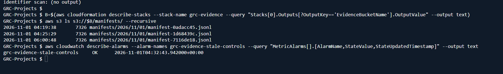
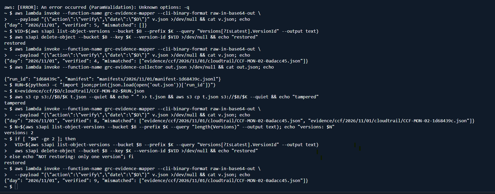
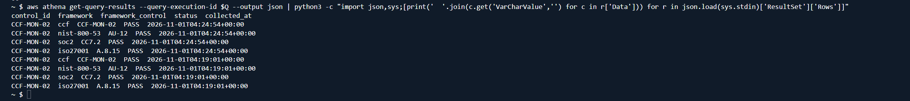
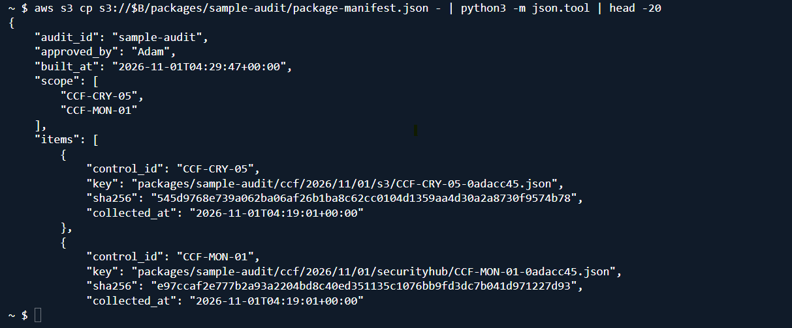

# Final report: 06 Audit Evidence Automation

Engineer: Maria. Partner and ISSO validation: Adam. Build week: Week 1, Oct 19 to 25, 2026 (extension requested on GRC-7). Deployed 2026-10-31 (tag `live-2026-10-31`) and updated 2026-11-02 (tag `live-2026-11-02`, PR #175). Jira epic: [GRC-7](https://340collective.atlassian.net/browse/GRC-7).

## 1. Summary

Built the `grc-evidence` CloudFormation stack ([PR #168](https://github.com/340Collective/GRC-Projects/pull/168), [PR #175](https://github.com/340Collective/GRC-Projects/pull/175)). It collects audit evidence daily and when a related setting changes, hashes every object (SHA-256) and lists it in a manifest, stores it in a temporary KMS-encrypted S3 evidence lake, maps it to controls in DynamoDB, makes it queryable in Athena, builds per-audit packages only after the owner approves the scope, and alarms when evidence goes stale.

It covers the 6 first-wave controls in REQUIREMENTS.md ([PR #159](https://github.com/340Collective/GRC-Projects/pull/159)), with the crosswalk Adam confirmed on [issue #34](https://github.com/340Collective/GRC-Projects/issues/34):

| Control | Evidence | Freshness window | NIST 800-53 | SOC 2 | ISO 27001:2022 |
| --- | --- | --- | --- | --- | --- |
| CCF-IAC-17 | IAM credential report (usernames tokenized) | 720 hours | AC-2, IA-5 | CC6.2 | A.5.18 |
| CCF-IAC-06 | Root and console-user MFA | 168 hours | IA-2(1), IA-2(2) | CC6.1 | A.8.5 |
| CCF-MON-02 | CloudTrail multi-region, log file validation, logging, last delivery | 24 hours | AU-12 | CC7.2 | A.8.15 |
| CCF-CRY-05 | S3 default encryption per bucket (bucket names tokenized) | 168 hours | SC-28, SC-28(1) | CC6.1 | A.8.24 |
| CCF-MON-01 | Security Hub pass rate and failed controls | 168 hours | CA-7 | CC4.1 | A.8.16 |
| CCF-CFG-02 | AWS Config recorder status and compliance per Config rule | 24 hours | CM-6, CA-7 | CC7.1 | A.8.9 |

ASFF `SecurityControlId` values: the pipeline is keyed by CCF control IDs. The CCF-MON-01 evidence records the Security Hub `SecurityControlId` of every failed finding for NIST 800-53 r5, AWS FSBP and CIS on each run, so the failing control list changes with the account and is read from the evidence rather than fixed here.

Audit Manager is not used: AWS is deprecating it, and this pipeline covers its function (06-DEV-1 on #34).

## 2. Before (manual)

Without the pipeline, evidence for these controls is gathered by hand in the AWS console: download a report or take screenshots, then file them by control for the auditor. To get a real baseline, the engineer did one full manual round for 5 controls on 2026-11-01 and timed each step (CCF-CFG-02 was skipped because no Config data was being collected at the time):

| Step | Manual time |
| --- | --- |
| CCF-IAC-17: download the IAM credential report | 32 s |
| CCF-IAC-06: check root and console-user MFA in the report | 22 s |
| CCF-MON-02: open the trail and record logging, multi-region, validation and last delivery | 1 min 22 s |
| CCF-CRY-05: open each of 11 buckets and record default encryption | 5 min 22 s |
| CCF-MON-01: record the Security Hub standard scores | 3 min 22 s |
| File the screenshots and report by control and write an index | 5 min |
| **Total for one round** | **about 16 min** |

What the manual way cannot show: no hash proves a screenshot or CSV was not changed later, nothing warns when evidence goes stale, the SOC 2 and ISO 27001 crosswalk has to be done by hand, and the S3 step grows with every new bucket. The manual screenshots showed the account ID and real resource names, so they were deleted after timing and are not part of this report.

## 3. After (automated)

- **Collection:** every control is collected daily at 06:00 UTC by the collector Lambda, and again right away when a related setting changes (for example CloudTrail StopLogging, bucket encryption deleted, MFA device removed, or the Config recorder stopped).
- **Integrity:** each evidence object is hashed with SHA-256 and listed in a daily manifest (`manifests/<yyyy>/<mm>/<dd>/`). The mapper's `verify` action recomputes every hash and lists any object that is missing or changed.
- **Mapping and query:** the mapper writes one control map row per control and framework to DynamoDB. Auditors query the manifests by control, framework and date in Athena (workgroup `grc-evidence`, 100 MB scan cap).
- **Packages:** the packager builds a per-audit bundle under `packages/<audit-id>/` only when the owner's approval is given (`approved_by` plus `approval_ref`, a link to the owner's approval comment on GitHub or Jira), only from evidence that passes the hash check, and only if every requested control has evidence. The package manifest records the approver, the approval link, the time, the scope and each item's hash.
- **Proof it runs unattended:** on 2026-11-01 the 06:00 UTC schedule produced run 7116de18 with no manual action (screenshot in section 5). On 2026-11-11 the daily runs for Nov 9, 10 and 11 were all present, and the stale-evidence alarm had stayed in OK since 2026-11-01.
- **Freshness:** a check at 07:00 UTC compares each control's newest evidence with its window. The `grc-evidence-stale-controls` alarm fires if any control is stale or if the check stops running, and publishes to the `grc-evidence-alerts` SNS topic.
- **Who is notified:** the engineer, by email through the `grc-evidence-alerts` SNS topic (subscribed at deploy with the `AlertEmail` parameter and confirmed on 2026-11-02; the address is not stored in git).
- **AWS Config:** CCF-CFG-02 reads the account's existing Config recorder (enabled outside this project) and reports FAIL if it is not recording. The stack does not own or change the recorder. The recorder covers all resource types except IAM. The account's 425 Config rules are Security Hub service-linked rules, whose results AWS exposes only through Security Hub (Config's own compliance calls return AccessDenied or an empty summary for them), so their compliance is evidenced in CCF-MON-01 and CFG-02 evidences the recorder itself.
- **Privacy:** usernames, trail names and bucket names are replaced with salted HMAC tokens before anything is written. No account IDs or ARNs are stored.

Known gaps:

- CloudTrail data events on the evidence lake are not enabled. The permissions boundary denies creating a trail, so the ISSM was asked on #34 to add an S3 data-event selector to the existing trail.
- The lake is temporary (30-day expiry, no Object Lock). This is a lab constraint, not audit-grade retention.
- The approval link is checked for format only; a reviewer follows it to confirm the approver and scope (the Lambda does not call GitHub).

Finding raised by the pipeline: CCF-IAC-06 reports FAIL. On 2026-11-02, 6 of 10 IAM users with console passwords had no MFA device (root MFA is on); it was still 6 of 10 on 2026-11-11. This is an account finding, not a pipeline defect, and was reported privately to the ISSM and IAM owner on GRC-7. The control returns to PASS automatically once fixed.

## 4. Metrics

From the builder's tests on 2026-11-01 (5 controls) and 2026-11-02 (6 controls, after PR #175), and Adam's ISSO validation on 2026-11-13:

| Metric | Result |
| --- | --- |
| Control coverage | 6 of 6 first-wave controls collected daily since 2026-11-02 |
| Time for one full collection | About 40 seconds (5 controls, 2026-11-01: 04:19:01 to 04:19:38 UTC); about 35 seconds for 6 controls (2026-11-02: 06:15:33 to 06:16:08 UTC) |
| Tamper detection | 1 of 1 edited objects detected; 1 of 1 deleted objects detected |
| Hash verification | 11 of 11 objects verified on 2026-11-02; Adam recomputed every package hash independently on 2026-11-13, all matching |
| Packaging | Built with owner approval and approval link (6 items, 2026-11-11); refused without `approval_ref`; refused for a control with no evidence |
| Least privilege | Auditor role refused raw evidence, another audit's package, writes and invoking the packager (Adam, 2026-11-13) |
| Freshness | 0 stale controls; alarm in OK since 2026-11-01 |
| Privacy | 0 usernames, account IDs or ARNs found in the IAM and Config evidence |
| Findings raised | CCF-IAC-06 FAIL (MFA, see section 3); all other controls PASS or informational |
| Security Hub findings | Baseline on 2026-10-22: NIST 800-53 r5 at 1,374 passed and 370 failed findings (about 79 percent). The current pass rate and failed control IDs are recorded daily in the CCF-MON-01 evidence |
| Time saved | One manual round takes about 16 minutes (section 2); the pipeline collects the same evidence in about 40 seconds with no one involved. At each control's freshness window (CloudTrail daily, MFA, S3 and Security Hub weekly, credential report monthly), manual collection alone would take about 16 hours a year, before filing |
| Time to remediate | Not measured in this build (the pipeline reports evidence and freshness; remediation is out of scope) |

## 5. Evidence

All screenshots are from CloudShell and contain no account IDs, ARNs or bucket names.

Scheduled run: two manual runs and one run started by the 06:00 UTC schedule, with the alarm in OK.



Tamper test (Test 3): `verify` flags an edited object, then passes after the original version is restored.



Athena query (Test 4): one control returns one row per framework for each collection run.



Package manifest (Test 5, 2026-11-01): approver, time, scope and a SHA-256 hash per item.



The package Adam validated (rebuilt on 2026-11-11 after PR #175 added the approval link), first lines of its manifest:

```text
"audit_id": "sample-audit",
"approved_by": "Adam",
"approval_ref": "https://github.com/340Collective/GRC-Projects/issues/34#issuecomment-6735522971",
"built_at": "2026-11-11T05:53:13+00:00",
"scope": ["CCF-CFG-02", "CCF-CRY-05", "CCF-IAC-06", "CCF-IAC-17", "CCF-MON-01", "CCF-MON-02"],
"items": 6 (one per control, each with its SHA-256)
```

Test summary:

| Test | 2026-11-01 (5 controls) | 2026-11-02 (6 controls, after PR #175) |
| --- | --- | --- |
| 1. Collect | Pass: 5 evidence objects and 1 manifest per run | Pass: 6 evidence objects, including CCF-CFG-02 |
| 2. Verify hashes | Pass | Pass: 11 verified, 0 mismatched |
| 3. Tamper | Pass: edit detected and restored; deletion also detected (note below) | Not repeated (no change to `verify`) |
| 4. Athena | Pass: CCF-MON-02 returns all 4 frameworks per run | Pass: new crosswalk rows (IA-2(1) and IA-2(2); CM-6, CA-7, CC7.1, A.8.9) |
| 5. Package | Pass: built with approval, refused without | Pass: built with approval link; refused without `approval_ref`; refused for an unknown control |
| 6. Freshness | Pass: no stale controls | Pass: no stale controls |

ISSO validation (Adam, 2026-11-13, through the read-only auditor role): Steps 2 to 4 of the test plan on #34 pass: all 6 controls and their crosswalk present in Athena, every package hash recomputed and matching, and every out-of-scope action refused.

Hash manifest: the daily manifests stay in the evidence lake and are not copied into git (raw evidence is not committed). The package manifest above shows the hash format.

Note on the deletion: a test-script error (an invalid CLI option) on 2026-11-01 deleted the CloudTrail evidence object from run 0adacc45. `verify` reports it as missing, which also shows deletion is detected. Packaging that control for that day now fails with a clear "missing" error, which led to the packager fix in PR #175.

## 6. Cost

Budget reads became available during the build; Cost Explorer (cost by tag) remains denied by the boundary. The account budget showed month-to-date spend of 1.07 dollars for 2026-11-01 to 2026-11-11 and a November forecast of 1.55 dollars, against the 10 dollar program cap. That covers every service in the account, so the 06 stack's own cost is below it. Estimate for the stack alone: about 1 to 2 dollars a month. The stack adds no AWS Config recording cost, since it reads the account's existing recorder.

## 7. Test cleanup and handover

Test artifacts:

- Local test files in CloudShell: deleted.
- Sample package `packages/sample-audit/`: kept until Adam's sign-off on #83 (it is what he validated), then deleted. Test package `sample-audit-2` (2026-11-02): deleted on 2026-11-13. The refused test requests built nothing.
- Test collection runs (0adacc45, 1d68439c, db506050): real evidence, kept; it expires with the lake after 30 days.
- No temporary users or trial-only resources were created.

What stays running in the shared system:

- Stack `grc-evidence` (us-east-1). The AWS Config recorder is not part of the stack.
- Schedules: collection daily at 06:00 UTC, freshness check daily at 07:00 UTC, plus on-change collection.
- Expected monthly cost: about 1 to 2 dollars for the stack (account total 1.55 dollars forecast for November, section 6).
- Alerts: the engineer's email, through the `grc-evidence-alerts` topic.

The end-of-program teardown steps are in [LAB-STEPS.md](LAB-STEPS.md). Deleting the stack leaves the account's AWS Config recorder running.

## 8. Sign-off

Partner results: Adam completed ISSO validation on 2026-11-13 (Steps 2 to 4 pass). His results go in `non-engineering/Adam-06-Evidence-Automation/RESULTS.md`; the link is added here once that file is on `main`.

Sign-off: Adam signs off on the [Final report item #83](https://github.com/340Collective/GRC-Projects/issues/83) against this report. Link to be added before merge.

Validation: ISSO validation by Adam, recorded on #83.

Phase assessment: Jason's phase assessment item, when it exists.
