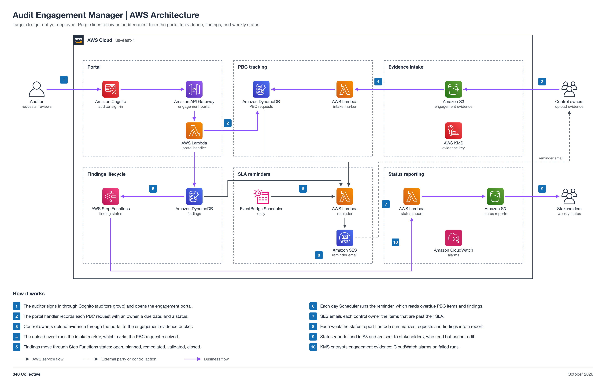

# Audit Engagement Manager

| Field | Value |
| --- | --- |
| Project | 10 Audit Engagement Manager |
| Your role | Maria (Automation Engineer), engineer: you design, deploy, test, and hand over to operation; you also run the end-of-program teardown |
| Your partner | Jason (Internal Auditor) |
| Reviewer or validator | Code review: Rasheed. Sign-off: Jason, a pass or findings record on the Final report item, not an approval. Validation: Adam, on the Final report item. Final approval: Faris, who merges. |
| Phase | Phase 2, 2 points (M) |
| Week | Week 2, Oct 26 to Nov 1, 2026 |
| Jira epic | [GRC-11](https://340collective.atlassian.net/browse/GRC-11) |
| Mirrored folder | [non-engineering/Jason-10-Audit-Engagement-Manager](../../non-engineering/Jason-10-Audit-Engagement-Manager/README.md) |
| Lab guide | [LAB-STEPS.md](LAB-STEPS.md) for this folder, and the general guide [shared/labs/README.md](../../shared/labs/README.md) |

Your part: You build the engagement tracker. Work with Jason (Internal Auditor): he gives you the PBC request list template and the findings SLA rules, then runs the acceptance test and records it in his own folder.

<details>
<summary>Lab steps summary</summary>

Full steps: [LAB-STEPS.md](LAB-STEPS.md). Mirror: [the other track's lab steps](../../non-engineering/Jason-10-Audit-Engagement-Manager/LAB-STEPS.md).

- Design: 5 steps
- Deploy: 4 steps
- Test: 3 steps
- Partner test: 3 steps
- End-of-program teardown: 5 steps

</details>

<details>
<summary>Working with your partner</summary>

- Day 1 kickoff: you and Jason agree on scope and requirements.
- Days 2 to 6, build and code review: talk to Jason as needed, or comment on the project item.
- Day 7 sign-off: you commit FINAL-REPORT.md to this folder. Jason commits his results to his own folder, compares them with your report, and signs off on the Final report item (pass, or findings, not an approval). Faris merges your pull request only after that sign-off. The build stays deployed and running in the shared system.

</details>

<details>
<summary>Jira</summary>

- Epic: [GRC-11](https://340collective.atlassian.net/browse/GRC-11).
- Ask your partner directly or comment on the project item. Jira is for task tracking only. The partner's sign-off and Adam's validation go on the Final report item, and the partner's results are in their own folder. Template and build pull requests merge after code review and final approval, so the stack can deploy. The pull request that finishes the project (FINAL-REPORT.md, `Closes #N`) links the project item and merges only after the sign-off.

</details>

<details>
<summary>Cost</summary>

Costs stay near zero at one engagement at a time.

The program cap is 10 dollars a month for the whole account, with budget alerts at 1, 5, and 10 dollars.

</details>

<details>
<summary>End-of-program teardown</summary>

- Not a Day 7 step. After sign-off the stack stays deployed and running in the shared system. Test cleanup is separate: after every test, delete the test data, restored copies, temporary users, and trial-only resources the test made. Run the steps below only in the [end-of-program teardown](../../GOVERNANCE.md#end-of-program-teardown).
- Empty every `grc-*` bucket the stack created, including all object versions and delete markers.
- Delete the `grc-audit-engagement` stack from clean `main` and wait for `DELETE_COMPLETE`.
- Remove any SES test identity the stack did not create.
- Record teardown evidence (stack deleted, buckets gone, services off, spend under the 1 dollar alert) where the ISSM designates, outside git, and note it on the Jira epic.

</details>

<details>
<summary>Frameworks covered</summary>

SOC 2 and ISO 27001:2022 audits (clauses 9.2 and 10.2), NIST CSF 2.0 ID.IM.

</details>

An AWS-native manager for the audit engagement lifecycle, run by the GRC analyst. It tracks every provided by client (PBC) request with an owner and a due date, takes evidence uploads through an authenticated portal, moves each finding through an explicit remediation path, sends SLA reminders for anything overdue, and emails stakeholders a weekly status report. It supports SOC 2 and ISO 27001:2022 external audits (clause 9.2 internal audit and clause 10.2 corrective action) and NIST CSF 2.0 ID.IM. PBC tracking, evidence intake, the finding state machine, reminders, and status reporting are automated; the auditor validates each remediation before a finding closes.

Status: target design, not yet deployed.



## Automation moving parts

1. A DynamoDB PBC request list holds each request with its owner, due date, and status.
2. Control owners upload evidence through the portal to S3 under `engagement/<id>/pbc/<request>/`.
3. An S3 event Lambda (the intake marker) marks the matching request received.
4. Findings and remediation run as a Step Functions state machine: open, remediation planned, remediated, validated, closed.
5. EventBridge Scheduler runs a daily reminder that emails owners about overdue PBC items and findings through SES.
6. The portal runs on API Gateway and Lambda behind a Cognito user pool with auditor and stakeholder groups.
7. A weekly status report Lambda writes the report to S3 and emails stakeholders.

## 340 Collective testbed

340 Collective's real AWS infrastructure is the environment this design is validated against. The first engagement is a mock audit of 340 Collective, with the [09 Control Testing](../Rasheed-09-Control-Testing/README.md) workpapers as the auditor's input and 340 Collective's own evidence as the PBC responses. No client data, account identifiers, or resource names are published in this repo.

## Files

| File | What it is |
| --- | --- |
| [diagram/audit-engagement-aws-architecture.png](diagram/audit-engagement-aws-architecture.png) | Architecture diagram (PNG, 2x) |
| [diagram/audit-engagement-aws-architecture.svg](diagram/audit-engagement-aws-architecture.svg) | Same diagram as a scalable SVG |
| [diagram/build_diagram.py](diagram/build_diagram.py) | Script that regenerates the diagram and runs its layout and sensitive-text checks |
| [Audit-Engagement-Architecture.md](Audit-Engagement-Architecture.md) | Stage-by-stage breakdown: portal, PBC tracking, evidence intake, findings lifecycle, SLA reminders, status reporting, data model, security, cost note, build order |
| [LAB-STEPS.md](LAB-STEPS.md) | Engineering lab steps: design, deploy, test, partner test, end-of-program teardown |
| [Partner lab steps](../../non-engineering/Jason-10-Audit-Engagement-Manager/LAB-STEPS.md) | The partner's non-engineering lab steps and records, kept current by the partner |

## Regenerate the diagram

```bash
python3 diagram/build_diagram.py --setup          # once: venv + diagrams==0.25.1 (needs rsvg-convert from librsvg)
python3 diagram/build_diagram.py diagram/audit-engagement-aws-architecture
```

The script must print `crossings: 0`, `layout problems: none`, and `sensitive text: none`.

## Notes

- Approvers: the auditor (Cognito auditors group) opens findings and validates each remediation before a finding can close; the 340 Collective owner, as engagement owner, approves each remediation plan.
- The portal API uses a Cognito user pool with two groups (auditors, stakeholders), so it is never unauthenticated. Auditors get read-only access to evidence; stakeholders see status only. This is the same pattern as 07.
- Connections show design intent. Nothing is deployed yet, so no line is verified from IaC.
- Pairs with [09 Control Testing](../Rasheed-09-Control-Testing/README.md) (workpapers feed the engagement), [06 Evidence Automation](../Maria-06-Evidence-Automation/README.md) (closed engagements are archived as evidence), [07 Risk Register](../Rasheed-07-Risk-Register/README.md) (findings that stay open become risks), and [12 GRC Metrics](../Rasheed-12-Metrics-Reporting/README.md) (overdue findings are a KRI).
