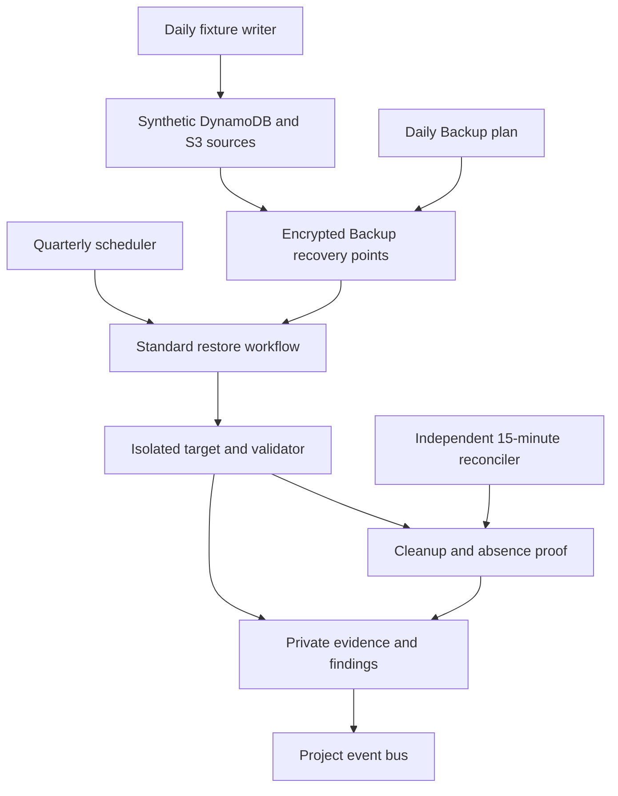
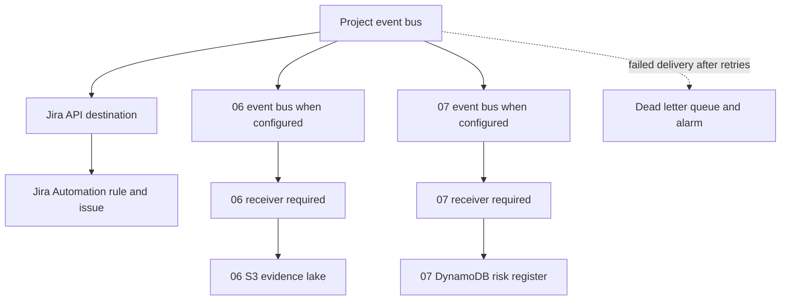

# BCP, disaster recovery and incident response plan

Project 13 review draft, 23 October 2026. Requirements basis: Draft v0.2, 20 October 2026, supplied updated governance and reviewed architecture/lab instructions. Actual owner assignments, targets, workload inventory and approvals remain unconfirmed. This plan authorizes no deployment or destructive action.

## Architecture and engineering comments

The supplied October 2026 diagram and five-stage automation table describe the same target flow. the requirements review response maps every stage and numbered step to this package, records the external receivers and specifies diagram/text annotations. Live completion remains unverified.

Business continuity keeps essential work moving; DR restores usable services and data; IR investigates and contains a security event while preserving evidence. Use one timeline and decision record across all three.

The routing paths below include required external receivers. The 06/07 routes are conditional and their consumers are outside this package; their displayed stores are not provisioned or populated by this stack.

The controller reads DynamoDB results and writes S3 reports. CloudWatch sends alarms through the approved subscribed topic; workflow/Janitor cleanup deletes restored targets. Shared encryption, boundary and CloudTrail controls and human approvals supplement the high-level flow; see the alignment note for verification criteria.

| Design choice | Reason and acceptance limit |
| --- | --- |
| One template and one operator command | Repeatable build/review/exercise/collection/teardown. Supporting IAM, logging, alarms, queue and schedules remain explicit CloudFormation resources. |
| Four Lambda functions | Fixture writes only installed synthetic sources/baselines; Controller restores/reports; Validate reads targets; Janitor cleans/monitors. DR roles have no source-write permission. |
| Two tiny synthetic sources | DynamoDB has eleven rows; S3 has three text objects and one timestamp marker. Full latest-content hashes are checked. This closes the architecture S3 path; real business-service recovery remains separate. |
| Unique targets and registered intent | Destination derives from a verified execution ARN. Register before creating, use stable idempotency tokens, and reconcile exact restore metadata after a lost response. Never replay an uncertain old restore blindly. |
| Independent cleanup | The workflow cleans normally. Janitor checks terminal workflows separately and waits for the restore writer to finish; a timeout or stop does not make a destination safe to abandon. It verifies target absence before finalization. |
| Failure remains visible | Integrity, target checks, cleanup and delivery have separate fields. The controlled fault changes the test verdict without falsifying the integrity result. Failed/aborted/late runs generate findings; unknown is not Pass. |
| Same-Region lab | Demonstrates only a scoped component recovery. It does not establish regional disaster, account compromise or provider-wide recovery. Record accepted disaster scenarios and jurisdiction before adding copies/accounts/Regions. |
| Existing controls | Every service role uses the existing boundary. Reuse the approved CMK, code bucket, subscribed SNS topic and Jira connection. Test effective grants and boundary intersections; matching template text alone is insufficient. |
| Native human approval | SSM captures the disposable bucket policy, requests the fixed approver, changes only that bucket, and captures after-state. Rejection/timeout aborts. Release requires another approval. No user-supplied target/approver exists. |
| Private raw evidence | CMK encryption, public blocking, TLS-only policies and versioning protect running report/IR buckets. Version/hash pins protect comparisons, not full forensic custody or immutability. Authorized programme-end teardown removes raw evidence after its retention/disposition decision. |
| Event contracts | `grc.bcdr` events carry schema 1.1, stable `event_id`, `finding_key`, `run_id`, correlation label, scope, targets, measurements, status and a version/hash-pinned private evidence pointer. Consumers deduplicate/upsert and must enforce access. |
| Optional 06/07 routing | Supply existing bus ARNs only after owner readiness. Project 07 is a Phase 2 consumer, currently unverified. Neither optional consumer is claimed live. Project 06 must copy evidence under the agreed running retention and before programme-end deletion. |
| Running operation | Runtime defaults off only for preparation. Once deployed, daily backup/fixture schedules, quarterly tests and the independent monitor remain running after sign-off. Removal occurs only at programme end; cost feasibility stays an owner decision. |

`examples/finding-event.json` is an offline schema fixture for Jira/Project 06/07 discussion. All-zero IDs, illustrative dates, null measurements and a non-live evidence pointer are deliberate. It is not an execution result, issue-creation proof or approval, and is not automatically sent anywhere. Actual events are produced only by the reviewed workflow.

### Backup, measurement and evidence contract

The running system protects an installed synthetic DynamoDB table and versioned S3 bucket with daily periodic AWS Backup snapshots, one CMK-encrypted vault, seven-day warm retention and no vault lock/cold tier. The separate fixture writer refreshes timestamped synthetic data at 02:00 UTC; backups run at 03:00 UTC and quarterly DR tests at 09:00 UTC. An explicit activation instant prevents backdated test obligations. Confirm exact cadence against accepted targets. Scheduled backup windows can run late; a plan alone does not prove its RPO.

Fixture refresh verifies the prior baseline, refuses unfinished DR runs or partial/drifted seeding, and shares a short atomic DynamoDB lease with new-run registration. A versioned/hash-pinned manifest covers all eleven rows and four latest S3 objects, including separate recovered timestamp markers. Never log content. An initial on-demand backup prepares the acceptance exercise; it does not replace ongoing daily protection.

S3 targets are unique per execution and are created as operational restore resources, outside the parent stack inventory. Before restore, the controller applies ownership tags, private access, versioning, TLS-only policy and CMK encryption. Cleanup requires matching execution-derived identity, owner/tags and exact restore metadata, waits for writers, deletes every object version/marker, deletes the bucket and checks absence. A creation interrupted before ownership tagging remains unresolved for an authorized evidence-based reconciliation; the code never adopts or deletes a same-name bucket blindly. S3 backup preserves object data, not bucket configuration, so configuration is rebuilt separately. Only latest object versions are validated/restored by this sample, not historical-version recovery.

The installed source fixtures are operating testbed data; every per-run restored copy is temporary and removed. Confirm this interpretation of test-data cleanup in the accepted scope. Source backup points and operational evidence persist under their lifecycle until the authorized end-of-program removal. Do not tear the installed stack down after Day 7.

Record these **separate milestones**:

| Milestone | Measurement |
| --- | --- |
| Disruption | Actual service disruption time, or explicitly simulated workflow start for the component test |
| Technical restore | Backup creation/completion and restore-job start/completion; diagnostic durations only |
| Integrity completion | All required content, consistency, encryption and access checks complete |
| Service recovery | Required dependencies reconnected and owner-approved usability checks pass |
| RTO | Disruption → usable data/service. Component RTO ends after validated usable table; service RTO ends after application usability. Round elapsed seconds up. |
| RPO | Disruption → latest successfully recoverable data timestamp, with proof of that timestamp. Never substitute backup-job completion or snapshot age. |
| Cleanup | Restore writer terminal, destination deletion and independent absence observation |

The recovered synthetic marker provides an interval: its server commit was between recorded client write start and acknowledgement. The component uses the oldest bound conservatively for RPO, rounded up, and retains the lower bound separately. This is a static-dataset measurement for explicit owner acceptance, not proof of live application transaction RPO. A stale marker fails the configured RPO even if the snapshot is new. Real client RPO needs actual recoverable application/transaction/content evidence.

The normal live configuration requires daily fixture refresh, daily backups and enabled quarterly scheduling. The independent monitor flags missing/late tests for both sources and reconciles aborted or timed-out executions. The optional `manage.py status` command checks that running configuration read-only. Handover is no longer a project deliverable or approval gate. Keep the installed stack running; retain the required test evidence and record actual cost through the existing reporting process.

Custom problem counters publish only when nonzero. The operations alarm sums the counters with missing-data non-breaching behavior; native monitor heartbeat and queue alarms remain. This reduces routine metric/API spend without disabling the required alarms. Live alarm behavior remains an acceptance check.

The result registry and version-pinned S3 reports preserve scoped outcomes. Evidence collection also reads backup/vault/source encryption, function roles/boundaries, execution history, native SSM records and selected CloudTrail management events. It stores actual supplied SSM/tabletop records under their IR prefixes and emits BCDR Evidence Record pointers to the configured 06 route; consumer persistence remains unverified. Review effective access denials, audit configuration/data-event selectors and actual billed/usage records independently. `PutEvents` acceptance, HTTP 200, a policy snapshot or a supplied evidence reference is never full downstream/control proof.

## Business continuity and service recovery

### Priorities and inventory

The business/service owner ranks essential client commitments, client-file access, public information and payment/dispute response. Record the maximum tolerable interruption and accepted recovery order, including dependencies; do not invent priorities for the organization. Use role contacts in the approved private directory and an alternate communication channel if Workspace is affected.

For each real service, fill `service-inventory.example.json` privately: hosting/data owner, authoritative source/config/content revisions, data classification/size, backup method/location/encryption/retention, consistency checks, identity/key/network/DNS/TLS/config/payment dependencies, deployment/restore runbook, authorization, rollback, accepted RTO/RPO, measurement evidence and service acceptance. Record access loss, Region/account loss and provider outage scenarios separately. Missing inventory is a feasibility finding, not permission to assume a platform or target production.

### Website recovery procedure

1. Obtain the accepted scenario, scope and authorization. Record disruption time, source/config/content revisions, latest recoverable content timestamp and evidence. Verify the last known-good versions are accessible outside the failed dependency.
2. Identify the actual approved hosting and dependency resources from inventory. Validate identity, existing keys/secrets access, network, DNS authority, TLS certificate and configuration. Use the existing approved CloudFormation workload template to recreate its required hosting/configuration in an authorized isolated destination; reconcile any existing resources before applying changes. This lab template creates the test harness, not an invented website platform.
3. Build/deploy the reviewed version-controlled source and configuration, restore versioned content from its approved recovery location, and validate count/hash/content plus recoverable timestamp. Do not embed secrets in source or treat source code alone as a backup of mutable content.
4. Reconnect the authorized dependencies and check public DNS resolution, valid TLS, expected content, essential navigation/forms and authentication/payment flows where applicable. Use synthetic transactions and provider-approved sandboxes. Keep the public smoke body deterministic and below 1 MiB if using the included hash checker. Record actual test times and evidence for each dependency.
5. Change routing/DNS only with the responsible owner's approval and rollback plan. Confirm the intended user path is usable, record service recovery time and compare RTO/RPO with **accepted** targets. Proposed values are 8h/24h. An isolated rehearsal must clearly state that live DNS/cutover was not performed.
6. Service owner accepts return to service and residual risk; record monitoring, communications, rollback criteria and final cleanup. A successful HTTP GET supplements the full usability evidence and does not prove every workflow.

### Client-data recovery procedure

1. Obtain authorization and classify scope without exporting real client information into the lab. Record disruption time, exact data stores, consistency groups, latest successfully recoverable data timestamp and its evidence. Determine whether keys, identity, storage or application compromise affects backup trust.
2. Confirm recovery point status, source, account/Region/location, encryption/key availability, retention, restore permissions, audit coverage and corruption/exposure window. Select a known-good point before the incident as needed; a newer compromised point is not necessarily appropriate.
3. Restore into an isolated authorized destination using the actual store's approved procedure. For the first permitted demonstration, run the supplied synthetic DynamoDB/S3 workflow. For a real service, the owner maps the actual database/file-storage resources and application restore order before any action. Never overwrite the source or restore unapproved data to a lower-trust environment.
4. Validate full synthetic hashes/counts for the lab. For real stores use accepted counts/checksums, object/file versions, referential/transaction consistency, application semantics, data timestamp and access checks, proportionate to classification/scale. Confirm encryption and authorized access; give the validator only required read access.
5. Reconnect application configuration, service identities, key access, network paths and external dependencies under change control. Prove authorized synthetic read **and write**, expected consistency and the actual client workflow. Confirm unauthorized access remains denied. Record technical restore, integrity and usable-service times separately.
6. Compare service RTO/RPO with accepted targets; proposed values are 4h/24h. Retain failed or unknown measures as Findings. Obtain service-owner return-to-service approval, reconcile queued work, monitor, and remove isolated destinations with absence evidence after approved retention.

### Continuity while services are unavailable

The commander and service owner agree which client commitments to pause, the next update time, safe alternate communications and a restricted log of work awaiting reconciliation. Use approved alternate access only. Do not transfer client records to personal accounts or unapproved storage to continue work. Route payment/Stripe dispute notices to the authorized business owner using the provider's approved procedure; a dispute alone is not proof of a security incident. Record manual work, owners and eventual reconciliation to avoid lost or duplicate transactions.

### Dependency readiness record

| Dependency | Owner evidence before reliance |
| --- | --- |
| Workspace/identity | Authorized admin contact, alternative identity/communication access, audit availability, session/account recovery and verification procedure |
| KMS/keys/secrets | Approved source and destination grants, boundary intersections, recovery availability, safe rotation/rollback and denied unauthorized access |
| Network/cloud | Hosting/account/Region inventory, control-plane access, network paths, limits and recreation procedure |
| DNS/TLS | Authorized DNS change access, current records/TTL, certificates, propagation and rollback evidence |
| Configuration/content | Versioned source, configuration and mutable-content manifests; secrets kept separately; reproducible build |
| Payments/Stripe | Authorized owner, dispute-notice readiness, safe sandbox checks and provider recovery/escalation procedure |
| Detection/audit | GuardDuty, CloudTrail, Workspace and Stripe readiness/coverage/retention actually checked; gaps recorded |
| Evidence/risk/Jira | Approved integration contract, consumer access, deduplication, quota/readiness, audit result and required retention |

## Incident response plan - eight required sections

### 1. Purpose

Coordinate evidence-based detection, triage, authorized containment/eradication, usable-service recovery, communications and improvement. Preserve essential work and client trust. This review plan defines roles and decisions; it does not grant administrative authority.

### 2. Scope

Client files/data, Google Workspace identity, website, relevant AWS resources and configuration, connected services and payment/dispute signals. The AWS automation is sandbox-only. A bucket-policy exercise cannot contain a real Workspace compromise. Record actual systems and exclusions in the private inventory.

### 3. Roles and contacts

| Role | Duty | Contact source |
| --- | --- | --- |
| Incident commander | Declare incident, severity, coordination, escalation, handover and closure | Approved private role directory; person to be assigned |
| BCDR engineer/technical responder | Build/test recovery, investigate technical scope, validate and supply facts | Approved private role directory |
| Workspace administrator | Authorized identity/session/access investigation and remediation | Approved private role directory |
| Business/service owner | Priorities, accepted targets, client impact and usable-service acceptance | Approved private role directory |
| Change approver | Approve impactful containment, eradication, cutover and rollback | Approved private role directory; independent of executor |
| Communications lead | Approved audience/channel/cadence and statements | Approved private role directory |
| Evidence custodian | Restricted originals, collection record, hashes/versions, access and approved retention | Approved private role directory |
| Privacy/legal adviser | Determine applicable exposure notification duties and deadlines | Approved private escalation directory |
| Facilitator/scribe | Timebox tabletop and record decisions, evidence, actions and due dates | Assign privately for exercise |

Use role labels publicly. Confirm coverage and an alternate contact/channel before the exercise. Jason assesses Pass/Findings; Adam validates; Faris gives final project approval. These project review roles do not automatically grant operational containment authority.

### 4. Detection and triage

Inputs include user reports, Workspace sign-in/access audits, GuardDuty findings, CloudTrail activity and Stripe dispute notices. Their actual readiness, delivery, scope and retention are **unverified**; an assigned owner confirms each before reliance. The lab does not enable these business sources or claim their coverage.

Open a restricted incident record with ID, detected time/timezone, reporter role, suspected systems/identities, impact, active exposure, evidence pointers and uncertainty. Preserve originals before changes where practicable. Separate confirmed facts from hypotheses. Proposed severity: critical for ongoing client exposure/privileged compromise or essential-service loss; high for credible limited compromise; lower for contained suspicious activity without confirmed access. Commander accepts/refines thresholds and revises severity as evidence changes.

Immediately escalate continuing exposure/privileged compromise to the commander, administrator, owner and approver. Engage privacy/legal promptly for credible client-data access/exfiltration; they determine actual obligations and timing. Escalate a target at risk before its deadline with elapsed time, blockers and options. At declaration set audience, approved channel, next update time and cadence. External communications need the responsible owner's approval. No messages are sent by this package.

### 5. Containment and evidence

Record UTC acquisition time, source, collector role, immutable/versioned original where supported, hash, access restrictions and transfers in the custody record. Preserve relevant authorized authentication, file-access, alert, configuration and timeline evidence privately. Keep client contents, credentials, phishing URLs and raw audit logs out of public Git. Versioning is useful but not a complete forensic custody system. Retention follows the approved incident decision, distinct from the approved running-system retention.

Propose the smallest effective containment with exact scope, impact, evidence-preservation effect, rollback and authorization. Impactful/destructive/irreversible changes require explicit human approval before execution; emergency authority must already be documented, not inferred here. For Workspace, the authorized administrator follows the accepted provider procedure for account/session/access controls and verifies results. Never bulk-delete files or broadly revoke shared access from this lab.

For the disposable AWS demonstration, capture before-policy → fixed human approval → sandbox write quarantine → capture after-policy. Rejection or timeout aborts the policy change. A separate approved release returns its baseline TLS-only policy. Record the native Automation execution and CloudTrail approval/action history. Test the sandbox denial safely under approved audit settings. Preserve relevant evidence before release/cleanup.

### 6. Eradication

Confirm entry path and scope. Under the authorized administrator procedure remove unauthorized access/persistence, review OAuth/connected applications and sharing, and rotate affected credentials/tokens in a dependency-aware order. Protect evidence, coordinate service owners and have a rollback/recovery route for legitimate consumers. Verify old access fails and intended access/control posture works. Exact provider operations belong to the confirmed owner procedure; no privileged Workspace/Stripe actions are implemented by these Lambda roles.

### 7. Recovery

Use known-good, integrity-checked recovery sources and the service procedures above. Verify identity/key/network/DNS/config/payment dependencies and usability before declaring recovery. Record technical restore, integrity and service recovery separately; compare disruption-to-usable RTO and recoverable-data-time RPO with accepted targets. Proposed client values are 4h/24h and website 8h/24h. Unknown/exceeded measurements are findings.

Maintain essential-work priorities and approved alternate communications. Service owner authorizes return to normal after required checks; commander records residual risk, monitoring, paused-work reconciliation and next updates. Communications lead obtains approval for recovery/impact statements and avoids unsupported claims about data exposure. A synthetic table Pass does not establish business-service recovery.

### 8. Lessons learned

Review timeline, cause, decisions, detection/containment gaps, recovery measurements, communications and cost. Give every action a named owner role, real due date, verification method and review state. Preserve the approved sanitized summary and restricted originals according to retention. Record Jason's assessment, Adam's validation and Faris's final approval separately. Closure requires service acceptance and follow-up ownership, not merely a successful restore job.

## 60-minute tabletop

**Prepared, not conducted.** Scenario: a staff member enters Google Workspace credentials into a phishing page; suspicious sign-in and possible client-file access follow. Use synthetic details, no real phishing, live malicious links or live containment. Assign people privately to the roles above, plus a facilitator and scribe.

| Minutes | Inject/activity | Required recorded decision/output |
| --- | --- | --- |
| 0-5 | Roles, objective, plan version and alternate channel | Attendance by role, scope, assumptions, private evidence location |
| 5-15 | Phished login and suspicious sign-in | Detected time, triage, severity, uncertainty and escalation |
| 15-25 | Possible client-file access | Preservation/custody, authorized containment, approval and exposure investigation |
| 25-35 | Sharing disrupted; client deadline approaching | Essential-work priority, approved workaround, communications and reconciliation owner |
| 35-45 | Access containment proposed complete | Eradication verification, known-good source, dependencies and recovery/target checks |
| 45-55 | Client asks whether information was exposed | Evidence-based statement, legal/privacy escalation, audience and approval |
| 55-60 | Debrief | Sanitized summary, gaps, action owners/due dates and follow-up test |

The real output must include exercise ID/date/timezone, plan version, actual start/end and total duration, roles, scope/assumptions, sanitized timeline, decisions/alternatives/authorizations, evidence pointers, continuity/recovery measures, communications, gaps and actions. Complete an incident report with **all ten fields below**. Do not substitute the fictional example for actual exercise records.

### Incident report form and completed fictional sample

The sample below is entirely fictional and describes imagined exercise decisions. It was **not** performed. Use the same field names for the real report.

| Required field | Completed fictional sample |
| --- | --- |
| Incident ID | EXERCISE-IR-001 - fictional training record |
| Date Detected | 1 October 2026, 09:00 UTC - fictional exercise clock |
| Reporter | Staff reporter role - synthetic participant |
| Severity | High in the fictional exercise: credible phished account with possible client-file access; critical escalation reserved for evidence of continuing exposure/privileged access |
| Systems Affected | Synthetic Workspace user and synthetic client-file workspace; website/payment compromise unconfirmed |
| Timeline | 09:00 report; 09:05 triage; 09:15 evidence and containment approval decision; 09:25 authorized-admin containment discussion; 09:30 continuity decision; 09:40 recovery checks discussed; 09:50 approved client-update wording; 10:00 debrief. All imagined UTC times. |
| Root Cause | Scenario assumes credential phishing. The group treated actual file access/exfiltration as unconfirmed pending sign-in and file-audit evidence. |
| Actions Taken | In the fictional discussion: commander assigned high severity; custodian listed authentication/file-audit preservation; approver authorized the proposed admin session/account procedure; owner paused unsafe sharing; responder listed identity/data/usability checks; communications lead drafted an uncertainty-aware update. No real system actions occurred. |
| Lessons Learned | Confirm audit availability/retention, alternate channel, administrator coverage, dependency-aware access recovery and the owner of exposure notification decisions. |
| Follow-Up Owner | Incident commander role; fictional actions and dates in the log below |

| Fictional action | Owner role | Fictional due date | Verification | State in sample |
| --- | --- | --- | --- | --- |
| Confirm Workspace audit collection and retention | Workspace administrator | 5 October 2026 | Approved evidence checklist and safe retrieval test | Open |
| Verify alternate contact channel | Communications lead | 5 October 2026 | Role-based contact drill | Open |
| Accept service checks and target measures | Service owner | 7 October 2026 | Recorded target/usability acceptance | Open |
| Re-test gaps and review closure | Incident commander | 9 October 2026 | Follow-up exercise and evidence review | Open |

For the real exercise replace all fictional entries, assign actual dates/owners, record completion evidence and publish only an approved sanitized summary. Keep personal contacts and raw Workspace/client evidence private.

## Assessment and decision record

Use the authoritative [Project 13 item](https://github.com/340Collective/GRC-Projects/issues/41). Record the accepted scope, scenario, targets/measurement method, budget, deployment/containment/service-acceptance authority, workload inventory, exception decisions, actual results, evidence references, residual risks and next test due date. The manager's trust in the SME supports reasoned pushback; it does not replace technical evidence, independent validation or formal approval.

Jason chooses Pass only if the accepted scope and every accepted criterion are demonstrated; otherwise Findings with owners/dates. Adam validates; Faris grants final approval. Update the authoritative requirements record through the approved repository process. The designed forced-failure integration creates the actual Jira finding automatically. No duplicate manual Jira project tracking is required.

## Official implementation references

- [S3 backup prerequisites and periodic versus continuous backups](https://docs.aws.amazon.com/aws-backup/latest/devguide/s3-backups.html).
- [S3 restore metadata, versioning and configuration limits](https://docs.aws.amazon.com/aws-backup/latest/devguide/restoring-s3.html).
- [AWS S3 backup policy reference](https://docs.aws.amazon.com/aws-managed-policy/latest/reference/AWSBackupServiceRolePolicyForS3Backup.html) and [restore policy reference](https://docs.aws.amazon.com/aws-managed-policy/latest/reference/AWSBackupServiceRolePolicyForS3Restore.html). These inform the custom scoped policies; do not attach broad policies to bypass the boundary. Periodic snapshots avoid the extra continuous-backup managed-rule dependency; effective permissions remain unverified until exercised.
- [Scheduler context attributes](https://docs.aws.amazon.com/scheduler/latest/UserGuide/managing-schedule-context-attributes.html) supply a stable scheduled instant for duplicate fixture-refresh handling.
