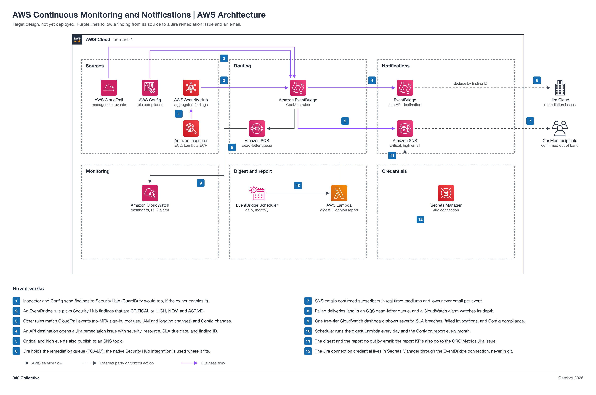

# AWS Continuous Monitoring and Notifications

| Field | Value |
| --- | --- |
| Project | 15 AWS Continuous Monitoring and Notifications |
| Your role | Rasheed (ISSE / Engineer), engineer: you design, deploy, test, and tear down |
| Your partner | Adam (ISSO) |
| Reviewer or validator | Code review: Maria. Acceptance and validation: Adam, in Jira. Final approval: Faris. Jason assesses in Phase 5. |
| Phase | Phase 5, 2 points (M); needs findings from 01 and 11, and posts to 12's GRC Metrics issue |
| Week | Week 5, Nov 16 to 22, 2026 |
| Jira epic | [GRC-31](https://340collective.atlassian.net/browse/GRC-31) |
| Mirrored folder | [non-engineering/Adam-15-AWS-ConMon](../../non-engineering/Adam-15-AWS-ConMon/README.md) |
| Lab guide | [LAB-STEPS.md](LAB-STEPS.md) for this folder, and the general guide [shared/labs/README.md](../../shared/labs/README.md) |

Your part: You build the ConMon layer: EventBridge routing, Jira remediation issues, critical and high email, the daily digest, the dashboard, and the monthly report. Work with Adam (ISSO): he gives you the ConMon plan, then accepts your build in Jira. Maria (Automation Engineer) does your code review. It sits next to your 12 and 13.

<details>
<summary>Lab steps summary</summary>

Full steps: [LAB-STEPS.md](LAB-STEPS.md). Mirror: [the other track's lab steps](../../non-engineering/Adam-15-AWS-ConMon/LAB-STEPS.md).

- Design: 9 steps
- Deploy: 4 steps
- Test: 6 steps
- Partner test: 3 steps
- Tear down: 5 steps

</details>

<details>
<summary>Working with your partner</summary>

- Day 1 kickoff: you and Adam agree on scope and requirements.
- Days 2 to 6, build and code review: talk to Adam as needed, or comment on the project item.
- Day 7 sign-off: you fill in FINAL-REPORT.md, Adam reviews it and signs off ("Accepted by: <first name>", or findings) as a comment on the Final report item, then merge and tear down.

</details>

<details>
<summary>Jira</summary>

- Epic: [GRC-31](https://340collective.atlassian.net/browse/GRC-31).
- Ask your partner directly or comment on the project item. The partner's sign-off and Adam's validation go on the Final report item. A pull request in this repo links the project item and merges only after the sign-off.
- Jira path 1: findings reach Jira through the native [Security Hub to Jira Cloud integration](https://docs.aws.amazon.com/securityhub/latest/userguide/jiracloud.html).
- Jira path 2: project events reach Jira through an EventBridge rule to the Jira REST API (an API destination) or a Jira Automation incoming webhook.

</details>

<details>
<summary>Cost</summary>

About 0 to 1 dollar a month: AWS service events on the default bus are free, SNS email and Lambda stay in their free tiers, one CloudWatch dashboard is free, and the connection secret is about 0.40 dollars.

The program cap is 10 dollars a month for the whole account, with budget alerts at 1, 5, and 10 dollars.

</details>

<details>
<summary>Teardown</summary>

- Tear down after the partner's sign-off and final approval are on the Final report item, before the phase ends.
- Delete the `grc-conmon` stack from clean `main` and wait for `DELETE_COMPLETE`.
- Confirm no SNS subscription is left, and delete the dead-letter queue if it was retained.
- Disable GuardDuty if it was enabled for the lab, unless the owner keeps it on.
- Record teardown evidence (stack deleted, buckets gone, services off, spend under the 1 dollar alert) where the ISSM designates, outside git, and note it on the Jira epic.

</details>

<details>
<summary>Frameworks covered</summary>

NIST SP 800-53 CA-7, RA-5, SI-2, SI-4, IR-4, and CA-5; SOC 2 CC7.1 to CC7.3 and CC4.2; ISO 27001:2022 A.8.8 and A.8.16; NIST CSF 2.0 DE.CM.

</details>

A NIST CA-7 style continuous monitoring (ConMon) layer built only on native AWS services. EventBridge rules pick CRITICAL and HIGH Security Hub findings (Inspector and Config feed Security Hub; GuardDuty would too once it is enabled), plus specific CloudTrail events and Config compliance changes. Each becomes a Jira remediation issue with an SLA due date, critical and high email in real time through SNS, and a daily digest, a free-tier CloudWatch dashboard, and a monthly ConMon report follow. It supports NIST SP 800-53 CA-7, RA-5, SI-2, SI-4, IR-4, and CA-5, SOC 2 CC7.1 to CC7.3 and CC4.2, ISO 27001:2022 A.8.8 and A.8.16, and NIST CSF 2.0 DE.CM.

Status: target design, not yet deployed.



## How 15 differs from 01

- 01 owns the Security Hub hub and the one-ticket-per-event pattern for control findings.
- 15 adds the ConMon plan, severity routing, email notifications, a daily digest, SLA tracking, the CloudWatch dashboard, and the monthly ConMon report.

## Automation moving parts

1. Inspector (EC2, Lambda, ECR) and Config send findings to Security Hub.
2. An EventBridge rule picks findings that are CRITICAL or HIGH, NEW, and ACTIVE; other rules match CloudTrail events (sign-in without MFA, root use, IAM and logging changes) and Config `NON_COMPLIANT` changes.
3. The native Security Hub to Jira Cloud integration, or an EventBridge API destination, opens one Jira remediation issue per finding with severity, resource, SLA due date (critical 15 days, high 30, medium 90), and the finding ID as a dedupe key.
4. Critical and high events email confirmed subscribers through SNS; mediums and lows go only to the daily digest.
5. Every target has retries and an SQS dead-letter queue with a CloudWatch alarm on its depth.
6. A daily Lambda sends the digest, and a monthly run builds the ConMon report and posts its KPIs to the GRC Metrics Jira issue for 12.
7. One CloudWatch dashboard shows findings by severity, SLA breaches, notification failures, and Config compliance.

## 340 Collective testbed

340 Collective's real Security Hub, Inspector, Config, and CloudTrail activity is the data. No email addresses, tokens, or account identifiers are published in this repo.

## Files

| File | What it is |
| --- | --- |
| [diagram/aws-conmon-architecture.png](diagram/aws-conmon-architecture.png) | Architecture diagram (PNG, 2x) |
| [diagram/aws-conmon-architecture.svg](diagram/aws-conmon-architecture.svg) | Same diagram as a scalable SVG |
| [diagram/build_diagram.py](diagram/build_diagram.py) | Script that regenerates the diagram and runs its layout and sensitive-text checks |
| [AWS-ConMon-Architecture.md](AWS-ConMon-Architecture.md) | Sources, rules, Jira path, email, dashboard, reliability, monthly report, security, cost note, build order, teardown |
| [LAB-STEPS.md](LAB-STEPS.md) | Engineering lab steps: design, deploy, test, partner test, tear down |
| [Partner lab steps](../../non-engineering/Adam-15-AWS-ConMon/LAB-STEPS.md) | The partner's non-engineering lab steps (reference; the partner works in Jira) |

## Regenerate the diagram

```bash
python3 diagram/build_diagram.py --setup          # once: venv + diagrams==0.25.1 (needs rsvg-convert from librsvg)
python3 diagram/build_diagram.py diagram/aws-conmon-architecture
```

The script must print `crossings: 0`, `layout problems: none`, and `sensitive text: none`.

## Notes

- Cost is about 0 to 1 dollar a month; the cost note in the architecture doc lists each item and its source.
- GuardDuty: planned, enabled later as code with owner approval. The detector goes in a GRC infrastructure template under `infrastructure/cloudformation/` with the optional protection plans off (S3 Protection, EKS, Malware Protection, RDS, Lambda, Runtime Monitoring, and AI Protection). It starts on the 30-day free trial, and GuardDuty's projected cost estimate in the console is read during the trial before deciding to keep it on.
- Phase 5: 15 needs findings from 01 (Phase 2) and 11 (Phase 3) and posts its monthly KPIs to the GRC Metrics issue that 12 builds in Phase 4, so it follows 12 and keeps Rasheed to one active build at a time.
- Connections show design intent. Nothing is deployed yet, so no line is verified from IaC.
