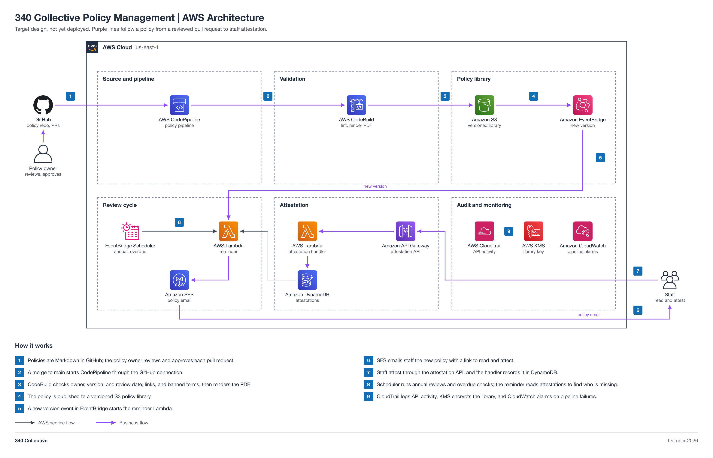

# 340 Collective Policy Management (non-engineering)

You push your own work to GitHub, in this folder, by pull request. Jira epic [GRC-6](https://340collective.atlassian.net/browse/GRC-6) is for task tracking only.

| Field | Value |
| --- | --- |
| Project | 05 340 Collective Policy Management |
| Your role | Adam (ISSO), partner: requirements, inputs, acceptance, operation, and reporting |
| Your partner | Maria (Automation Engineer) |
| Reviewer or validator | Faris accepts your REQUIREMENTS.md at the Day 1 kickoff. You sign off and record your validation on the Final report item. Faris gives final approval. Faris reviews and merges your pull requests. |
| Phase | Phase 5, 1 point (S) |
| Week | Week 5, Nov 16 to 22, 2026 |
| Jira epic | [GRC-6](https://340collective.atlassian.net/browse/GRC-6) |
| Mirrored folder | [engineering/Maria-05-Policy-Management](../../engineering/Maria-05-Policy-Management/README.md) |
| Lab guide | [LAB-STEPS.md](LAB-STEPS.md) for this folder, and the general guide [shared/labs/README.md](../../shared/labs/README.md) |

Your part: You own the six policies and their review cycle. Work with Maria. Give her the drafts at the Day 1 kickoff, then test her build and record your results here.

Lab steps summary

Full steps: [LAB-STEPS.md](LAB-STEPS.md). Mirror: [the other track's lab steps](../../engineering/Maria-05-Policy-Management/LAB-STEPS.md).

- Define requirements: 5 steps
- Share inputs: 1 step
- Test the build: 2 steps
- Operate it: 2 steps
- Assess or report: 1 step

Working with your partner

- Day 1 kickoff: write REQUIREMENTS.md in this folder and open a pull request. You and Maria agree on scope. Faris accepts the requirements and merges the pull request.
- Days 2 to 6, build and code review: talk to Maria as needed, or comment on the project item.
- Day 7 sign-off: Maria commits FINAL-REPORT.md to the engineering folder. You commit your test and operating results to RESULTS.md in this folder, compare them with the engineer's report, and sign off on the Final report item ("Accepted by: <first name>", or findings) with a link to your results. Faris merges the engineer's pull request only after your sign-off. The build stays deployed and running in the shared system.
- Integration week (Nov 23 to 25): check the handoffs across your projects and commit your final results to RESULTS.md.

Jira

- Epic: [GRC-6](https://340collective.atlassian.net/browse/GRC-6).
- Ask your partner directly or comment on the project item. Jira is for task tracking only. Your requirements and results go in this folder by pull request, and Faris reviews and merges them. Engineers never edit this folder. This repo is public. Redact account IDs, ARNs, real resource names, personal emails, and client data before you commit.

Cost

Your side costs nothing. The build's cost is in the engineering README.

CodeBuild build minutes are the only real cost; keep test builds few.

The program cap is 10 dollars a month for the whole account, with budget alerts at 1, 5, and 10 dollars.

End-of-program teardown

- After sign-off the build stays running in the shared system, and you operate it and report. Maria removes it only in the end-of-program teardown.
- At the end-of-program teardown, confirm on the project item that the teardown evidence is recorded.

Frameworks covered

SOC 2 CC1.4 and CC5.3, ISO 27001:2022 A.5.1 and clause 7.5, NIST CSF 2.0 GV.PO.

## About the project

340 Collective's security policies as versioned Markdown, reviewed by pull request, with attestation tracking and review reminders. It supports SOC 2 CC1.4 and CC5.3, ISO 27001:2022 A.5.1 and clause 7.5, and NIST CSF 2.0 GV.PO.

Status: target design, not yet deployed.

## Files

| File | What it is |
| --- | --- |
| [LAB-STEPS.md](LAB-STEPS.md) | Your lab steps: define requirements, share inputs, test the build, operate it, assess or report |
| [Engineering README](../../engineering/Maria-05-Policy-Management/README.md) | The build view: design, moving parts, and regenerate commands |
| [Policy-Management-Architecture.md](../../engineering/Maria-05-Policy-Management/Policy-Management-Architecture.md) | Architecture doc |
| [Engineering lab steps](../../engineering/Maria-05-Policy-Management/LAB-STEPS.md) | Maria's lab steps, mirrored with yours |
