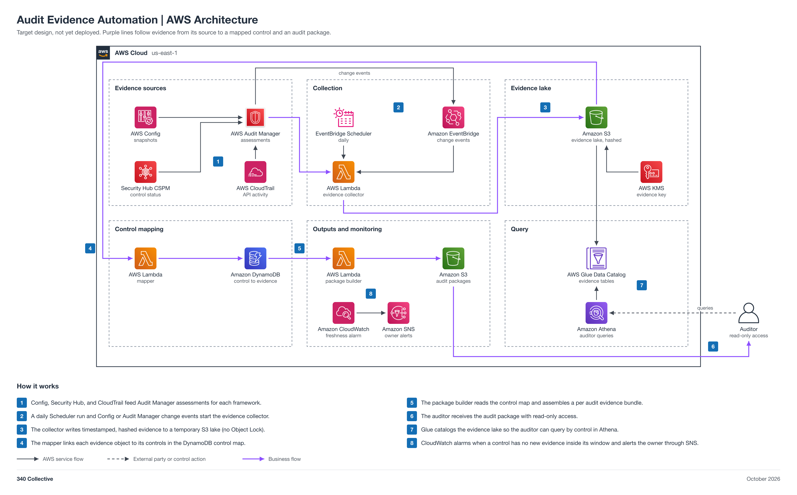

# Audit Evidence Automation (non-engineering)

You work in Jira. Your epic: `GRC-<NN>` (a placeholder until Faris creates it). This page is reference.

| Field | Value |
| --- | --- |
| Project | 06 Audit Evidence Automation |
| Your role | Adam (ISSO), partner: requirements, inputs, acceptance, operation, and reporting |
| Your partner | Maria (Automation Engineer) |
| Reviewer or validator | Faris (ISSM) accepts your Handoff 1 requirements. You accept and validate the build in Jira; Faris gives final approval. |
| Phase | Phase 1, 3 points (L) |
| Week | Week 1, Oct 19 to 25, 2026 |
| Jira epic | `GRC-<NN>` (a placeholder until Faris creates the epic) |
| Mirrored folder | [engineering/Maria-06-Evidence-Automation](../../engineering/Maria-06-Evidence-Automation/README.md) |
| Lab guide | [LAB-STEPS.md](LAB-STEPS.md) for this folder, and the general guide [shared/labs/README.md](../../shared/labs/README.md) |

Your part: You own the evidence-to-control mapping. Work with Maria. Give her the control list by Handoff 1, then accept her build.

Lab steps summary

Full steps: [LAB-STEPS.md](LAB-STEPS.md). Mirror: [the other track's lab steps](../../engineering/Maria-06-Evidence-Automation/LAB-STEPS.md).

- Define requirements: 4 steps
- Hand over inputs: 1 step
- Accept the build: 2 steps
- Operate it: 2 steps
- Assess or report: 2 steps

Handoffs

- Handoff 1: control list for evidence mapping, Adam to Maria (Jira Task, created by Adam)
- Handoff 2: evidence pipeline ready for acceptance, Maria to Adam (Jira Task, created by Maria)
- Handoff 3: reviewed control-to-evidence index, Adam to Faris (Jira Task, created by Adam)

Jira

- Epic: `GRC-<NN>` (a placeholder until Faris creates the epic).
- Each numbered handoff is a Jira Task linked to the epic, created by the person who sends it.
- You record requirements, acceptance, and reports on the Tasks. You do not open or review pull requests; engineers keep this page current.

Cost

Your side costs nothing. The build's cost is in the engineering README.

Config recording, S3 storage (kept small by the 30 and 7 day expiry), and Athena scans are the drivers; partition by date and framework.

The program cap is 10 dollars a month for the whole account, with budget alerts at 1, 5, and 10 dollars.

Teardown

- Maria tears the build down after acceptance and approval.
- Confirm on the Jira Task that the teardown evidence is recorded.

Frameworks covered

SOC 2 and ISO 27001 audit evidence, mapped by control.

## About the project

Audit evidence collected from AWS on a schedule, hashed, written to a temporary evidence lake with no Object Lock, and mapped to controls so an auditor can query by control. It prepares the program for a SOC 2 or ISO 27001 audit.

Status: target design, not yet deployed.

## Files

| File | What it is |
| --- | --- |
| [LAB-STEPS.md](LAB-STEPS.md) | Your lab steps: define requirements, hand over inputs, accept the build, operate it, assess or report |
| [Engineering README](../../engineering/Maria-06-Evidence-Automation/README.md) | The build view: design, moving parts, and regenerate commands |
| [Evidence-Automation-Architecture.md](../../engineering/Maria-06-Evidence-Automation/Evidence-Automation-Architecture.md) | Architecture doc |
| [Engineering lab steps](../../engineering/Maria-06-Evidence-Automation/LAB-STEPS.md) | Maria's lab steps, with the same handoffs as yours |
