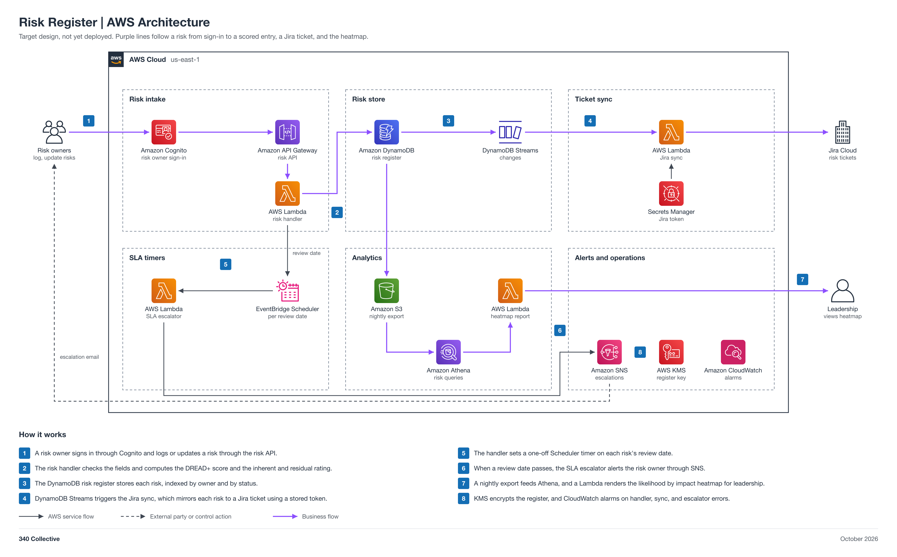

# Risk Register (non-engineering)

You work in Jira. Your epic: `GRC-<NN>` (a placeholder until Faris creates it). This page is reference.

| Field | Value |
| --- | --- |
| Project | 07 Risk Register |
| Your role | Adam (ISSO), partner: requirements, inputs, acceptance, operation, and reporting |
| Your partner | Rasheed (ISSE / Engineer) |
| Reviewer or validator | Faris accepts your Handoff 1 requirements. You accept and validate the build in Jira; Faris gives final approval. |
| Phase | Phase 2, 2 points (M) |
| Week | Week 2, Oct 26 to Nov 1, 2026 |
| Jira epic | `GRC-<NN>` (a placeholder until Faris creates the epic) |
| Mirrored folder | [engineering/Rasheed-07-Risk-Register](../../engineering/Rasheed-07-Risk-Register/README.md) |
| Lab guide | [LAB-STEPS.md](LAB-STEPS.md) for this folder, and the general guide [shared/labs/README.md](../../shared/labs/README.md) |

Your part: You own the risk scoring rules and the register. Work with Rasheed. Give him the rules and the seed register by Handoff 1, then accept his build.

Lab steps summary

Full steps: [LAB-STEPS.md](LAB-STEPS.md). Mirror: [the other track's lab steps](../../engineering/Rasheed-07-Risk-Register/LAB-STEPS.md).

- Define requirements: 5 steps
- Hand over inputs: 1 step
- Accept the build: 2 steps
- Operate it: 2 steps
- Assess or report: 2 steps

Handoffs

- Handoff 1: risk scoring rules and seed risk register (lab sheet), Adam to Rasheed (Jira Task, created by Adam)
- Handoff 2: risk register build ready for acceptance, Rasheed to Adam (Jira Task, created by Rasheed)
- Handoff 3: top five risk summary, Adam to Faris (Jira Task, created by Adam)

Jira

- Epic: `GRC-<NN>` (a placeholder until Faris creates the epic).
- Each numbered handoff is a Jira Task linked to the epic, created by the person who sends it.
- You record requirements, acceptance, and reports on the Tasks. You do not open or review pull requests; engineers keep this page current.
- Jira path 2: project events reach Jira through an EventBridge rule to the Jira REST API (an API destination) or a Jira Automation incoming webhook.

Cost

Your side costs nothing. The build's cost is in the engineering README.

There is no paid dashboard; Cognito, API Gateway, Lambda, DynamoDB, and Athena stay at or near the free tier.

The program cap is 10 dollars a month for the whole account, with budget alerts at 1, 5, and 10 dollars.

Teardown

- Rasheed tears the build down after acceptance and approval.
- Confirm on the Jira Task that the teardown evidence is recorded.

Frameworks covered

ISO 27001:2022 clauses 6.1 and 8.2, NIST CSF 2.0 GV.RM and ID.RA, SOC 2 CC3.

## About the project

A scored risk register with owners, treatments, review dates, and a heat map. It supports ISO 27001:2022 clauses 6.1 and 8.2, NIST CSF 2.0 GV.RM and ID.RA, and SOC 2 CC3.

Status: target design, not yet deployed.

## Files

| File | What it is |
| --- | --- |
| [LAB-STEPS.md](LAB-STEPS.md) | Your lab steps: define requirements, hand over inputs, accept the build, operate it, assess or report |
| [07-risk-register-lab.xlsx](07-risk-register-lab.xlsx) | Lab sheet: risk scoring rules and the seed register (your Handoff 1) |
| [Engineering README](../../engineering/Rasheed-07-Risk-Register/README.md) | The build view: design, moving parts, and regenerate commands |
| [Risk-Register-Architecture.md](../../engineering/Rasheed-07-Risk-Register/Risk-Register-Architecture.md) | Architecture doc |
| [Engineering lab steps](../../engineering/Rasheed-07-Risk-Register/LAB-STEPS.md) | Rasheed's lab steps, with the same handoffs as yours |
