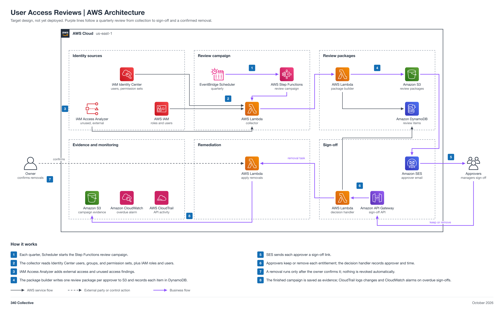

# User Access Reviews (non-engineering)

You push your own work to GitHub, in this folder, by pull request. Jira epic [GRC-9](https://340collective.atlassian.net/browse/GRC-9) is for task tracking only.

| Field | Value |
| --- | --- |
| Project | 08 User Access Reviews |
| Your role | Adam (ISSO), partner: requirements, inputs, acceptance, operation, and reporting |
| Your partner | Abdifatah (IAM / Identity Engineer) |
| Reviewer or validator | Faris accepts your REQUIREMENTS.md at the Day 1 kickoff. You sign off and record your validation on the Final report item. Faris gives final approval. Faris reviews and merges your pull requests. |
| Phase | Phase 2, 2 points (M) |
| Week | Week 2, Oct 26 to Nov 1, 2026 |
| Jira epic | [GRC-9](https://340collective.atlassian.net/browse/GRC-9) |
| Mirrored folder | [engineering/Abdifatah-08-Access-Reviews](../../engineering/Abdifatah-08-Access-Reviews/README.md) |
| Lab guide | [LAB-STEPS.md](LAB-STEPS.md) for this folder, and the general guide [shared/labs/README.md](../../shared/labs/README.md) |

Your part: You own the access review: the worksheet, the decisions, and the remediation log. Work with Abdifatah. Give him the worksheet columns and review rules at the Day 1 kickoff, then test his build and record your results here.

Lab steps summary

Full steps: [LAB-STEPS.md](LAB-STEPS.md). Mirror: [the other track's lab steps](../../engineering/Abdifatah-08-Access-Reviews/LAB-STEPS.md).

- Define requirements: 4 steps
- Share inputs: 1 step
- Test the build: 2 steps
- Operate it: 4 steps
- Assess or report: 2 steps

Working with your partner

- Day 1 kickoff: write REQUIREMENTS.md in this folder and open a pull request. You and Abdifatah agree on scope. Faris accepts the requirements and merges the pull request.
- Days 2 to 6, build and code review: talk to Abdifatah as needed, or comment on the project item.
- Day 7 sign-off: Abdifatah commits FINAL-REPORT.md to the engineering folder. You commit your test and operating results to RESULTS.md in this folder, compare them with the engineer's report, and sign off on the Final report item ("Accepted by: <first name>", or findings) with a link to your results. Faris merges the final report pull request only after your sign-off. The build stays deployed and running in the shared system.
- Integration week (Nov 23 to 25): check the handoffs across your projects and commit your final results to RESULTS.md.

Jira

- Epic: [GRC-9](https://340collective.atlassian.net/browse/GRC-9).
- Ask your partner directly or comment on the project item. Jira is for task tracking only. Your requirements and results go in this folder by pull request, and Faris reviews and merges them. Engineers never edit this folder. This repo is public. Redact account IDs, ARNs, real resource names, personal emails, and client data before you commit.

Cost

Your side costs nothing. The build's cost is in the engineering README.

The external access analyzer has no charge; the rest stays near the free tier at a quarterly cadence.

The program cap is 10 dollars a month for the whole account, with budget alerts at 1, 5, and 10 dollars.

End-of-program teardown

- After sign-off the build stays running in the shared system, and you operate it and report. Abdifatah removes it only in the end-of-program teardown.
- At the end-of-program teardown, confirm on the project item that the teardown evidence is recorded.

Frameworks covered

SOC 2 CC6.2 and CC6.3, ISO 27001:2022 A.5.18, NIST CSF 2.0 PR.AA.

## About the project

A quarterly user access review of the AWS identities, with approver sign-off and a remediation log. It supports SOC 2 CC6.2 and CC6.3, ISO 27001:2022 A.5.18, and NIST CSF 2.0 PR.AA.

Status: target design, not yet deployed.

## Files

| File | What it is |
| --- | --- |
| [LAB-STEPS.md](LAB-STEPS.md) | Your lab steps: define requirements, share inputs, test the build, operate it, assess or report |
| [uar-simulation](../../engineering/Abdifatah-08-Access-Reviews/uar-simulation/README.md) | Synthetic practice dataset for the access review (kept in the engineering folder) |
| [Engineering README](../../engineering/Abdifatah-08-Access-Reviews/README.md) | The build view: design, moving parts, and regenerate commands |
| [Access-Review-Architecture.md](../../engineering/Abdifatah-08-Access-Reviews/Access-Review-Architecture.md) | Architecture doc |
| [Engineering lab steps](../../engineering/Abdifatah-08-Access-Reviews/LAB-STEPS.md) | Abdifatah's lab steps, mirrored with yours |
