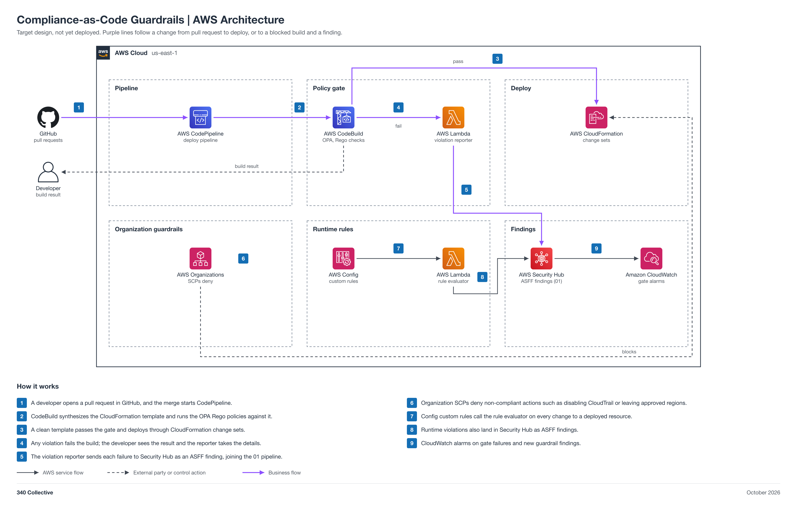

# Compliance-as-Code Guardrails (non-engineering)

You work in Jira. Your epic: `GRC-<NN>` (a placeholder until Faris creates it). This page is reference.

| Field | Value |
| --- | --- |
| Project | 11 Compliance-as-Code Guardrails |
| Your role | Adam (ISSO), partner: requirements, inputs, acceptance, operation, and reporting |
| Your partner | Alex (Security Automation Engineer) |
| Reviewer or validator | Faris (ISSM) accepts your Handoff 1 requirements. You accept and validate the build in Jira; Faris gives final approval. |
| Phase | Phase 1, 3 points (L) |
| Jira epic | `GRC-<NN>` (a placeholder until Faris creates the epic) |
| Mirrored folder | [engineering/Alex-11-Compliance-as-Code-Guardrails](../../engineering/Alex-11-Compliance-as-Code-Guardrails/README.md) |
| Lab guide | [LAB-STEPS.md](LAB-STEPS.md) for this folder, and the general guide [shared/labs/README.md](../../shared/labs/README.md) |

Your part: You own the guardrail list and the guardrail-to-control register. Work with Alex. Give him the list by Handoff 1, then accept his build.

Lab steps summary

Full steps: [LAB-STEPS.md](LAB-STEPS.md). Mirror: [the other track's lab steps](../../engineering/Alex-11-Compliance-as-Code-Guardrails/LAB-STEPS.md).

- Define requirements: 3 steps
- Hand over inputs: 1 step
- Accept the build: 2 steps
- Operate it: 1 step
- Assess or report: 2 steps

Handoffs

- Handoff 1: guardrail list and the control each enforces, Adam to Alex (Jira Task, created by Adam)
- Handoff 2: Rego rules, Config rules, and SCP outline ready for acceptance, Alex to Adam (Jira Task, created by Alex)
- Handoff 3: guardrail-to-control register, Adam to Faris (Jira Task, created by Adam)

Jira

- Epic: `GRC-<NN>` (a placeholder until Faris creates the epic).
- Each numbered handoff is a Jira Task linked to the epic, created by the person who sends it.
- You record requirements, acceptance, and reports on the Tasks. You do not open or review pull requests; engineers keep this page current.
- Jira path 1: findings reach Jira through the native [Security Hub to Jira Cloud integration](https://docs.aws.amazon.com/securityhub/latest/userguide/jiracloud.html).

Cost

Your side costs nothing. The build's cost is in the engineering README.

CodeBuild build minutes and Config rule evaluations are the drivers; keep test runs few. SCPs have no charge.

The program cap is 10 dollars a month for the whole account, with budget alerts at 1, 5, and 10 dollars.

Teardown

- Alex tears the build down after acceptance and approval.
- Confirm on the Jira Task that the teardown evidence is recorded.

Frameworks covered

SOC 2 CC8.1 and CC6.6, ISO 27001:2022 A.8.9 and A.8.32, NIST CSF 2.0 PR.PS.

## About the project

Preventive guardrails as code: Rego checks in the deploy pipeline, Config rules for drift, and an SCP outline, each tied to a control. It supports SOC 2 CC8.1 and CC6.6, ISO 27001:2022 A.8.9 and A.8.32, and NIST CSF 2.0 PR.PS.

Status: target design, not yet deployed.

## Files

| File | What it is |
| --- | --- |
| [LAB-STEPS.md](LAB-STEPS.md) | Your lab steps: define requirements, hand over inputs, accept the build, operate it, assess or report |
| [Engineering README](../../engineering/Alex-11-Compliance-as-Code-Guardrails/README.md) | The build view: design, moving parts, and regenerate commands |
| [Guardrails-Architecture.md](../../engineering/Alex-11-Compliance-as-Code-Guardrails/Guardrails-Architecture.md) | Architecture doc |
| [Engineering lab steps](../../engineering/Alex-11-Compliance-as-Code-Guardrails/LAB-STEPS.md) | Alex's lab steps, with the same handoffs as yours |
