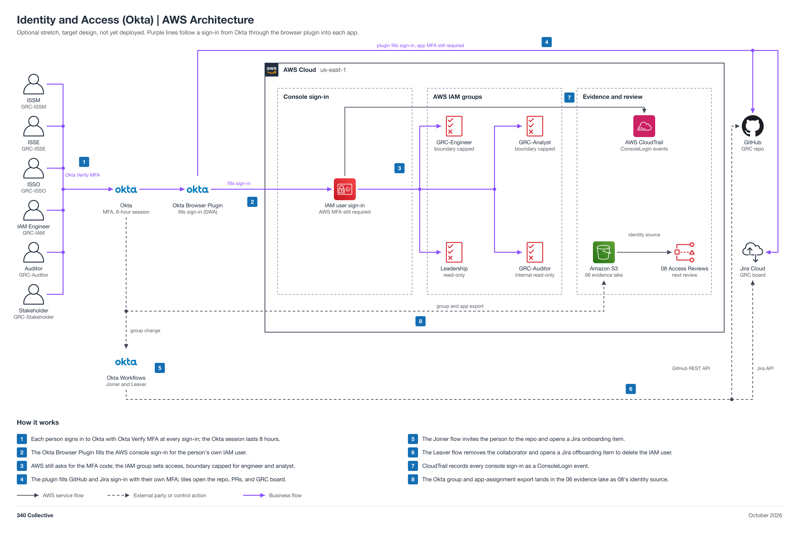

# Identity and Access (Okta) (non-engineering)

You work in Jira. Your epic: `GRC-<NN>` (a placeholder until Faris creates it). This page is reference.

| Field | Value |
| --- | --- |
| Project | 14 Identity and Access (Okta) |
| Your role | Adam (ISSO), partner: requirements, inputs, acceptance, operation, and reporting |
| Your partner | Abdifatah (IAM / Identity Engineer) |
| Reviewer or validator | Faris accepts your Handoff 1 requirements. You accept and validate the build in Jira; Faris gives final approval. |
| Phase | Phase 1, 2 points (M) |
| Week | Week 1, Oct 19 to 25, 2026 |
| Jira epic | `GRC-<NN>` (a placeholder until Faris creates the epic) |
| Mirrored folder | [engineering/Abdifatah-14-Identity-Access](../../engineering/Abdifatah-14-Identity-Access/README.md) |
| Lab guide | [LAB-STEPS.md](LAB-STEPS.md) for this folder, and the general guide [shared/labs/README.md](../../shared/labs/README.md) |

Your part: You own the Okta group model, the deviation record, and the identity export for 08. Work with Abdifatah. Give him the group model by Handoff 1, then accept his build.

Lab steps summary

Full steps: [LAB-STEPS.md](LAB-STEPS.md). Mirror: [the other track's lab steps](../../engineering/Abdifatah-14-Identity-Access/LAB-STEPS.md).

- Define requirements: 3 steps
- Hand over inputs: 1 step
- Accept the build: 2 steps
- Operate it: 1 step
- Assess or report: 3 steps

Handoffs

- Handoff 1: Okta group model and app assignment rules, Adam to Abdifatah (Jira Task, created by Adam)
- Handoff 2: Okta launch point and lifecycle workflows ready for acceptance, Abdifatah to Adam (Jira Task, created by Abdifatah)
- Handoff 3: accepted identity export for 08 and the deviation record, Adam to Faris (Jira Task, created by Adam)

Jira

- Epic: `GRC-<NN>` (a placeholder until Faris creates the epic).
- Each numbered handoff is a Jira Task linked to the epic, created by the person who sends it.
- You record requirements, acceptance, and reports on the Tasks. You do not open or review pull requests; engineers keep this page current.

Cost

Your side costs nothing. The build's cost is in the engineering README.

0 dollars on the Okta, GitHub, and Jira free plans.

The program cap is 10 dollars a month for the whole account, with budget alerts at 1, 5, and 10 dollars.

Teardown

- Abdifatah tears the build down after acceptance and approval.
- Confirm on the Jira Task that the teardown evidence is recorded.

Frameworks covered

SOC 2 CC6.1 to CC6.3, ISO 27001:2022 A.5.15 to A.5.18 and A.8.5, NIST CSF 2.0 PR.AA.

## About the project

Okta as the team's sign-in launch point for AWS, GitHub, and Jira, without single sign-on (recorded as a deviation), with joiner and leaver workflows and an identity export for 08. It supports SOC 2 CC6.1 to CC6.3, ISO 27001:2022 A.5.15 to A.5.18 and A.8.5, and NIST CSF 2.0 PR.AA.

Status: target design, not yet deployed.

## Files

| File | What it is |
| --- | --- |
| [LAB-STEPS.md](LAB-STEPS.md) | Your lab steps: define requirements, hand over inputs, accept the build, operate it, assess or report |
| [Engineering README](../../engineering/Abdifatah-14-Identity-Access/README.md) | The build view: design, moving parts, and regenerate commands |
| [Identity-Access-Architecture.md](../../engineering/Abdifatah-14-Identity-Access/Identity-Access-Architecture.md) | Architecture doc |
| [Engineering lab steps](../../engineering/Abdifatah-14-Identity-Access/LAB-STEPS.md) | Abdifatah's lab steps, with the same handoffs as yours |
