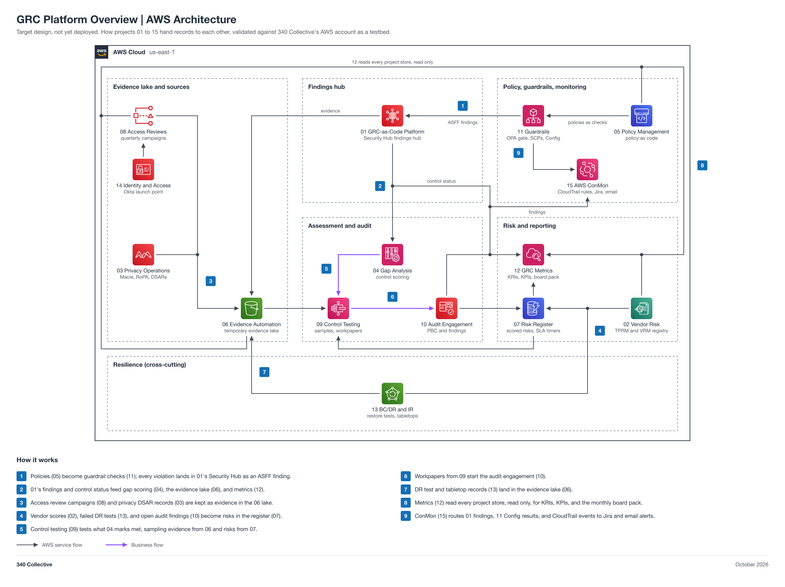

# GRC Platform Overview (non-engineering)

You work in Jira. Your epic: `GRC-<NN>` (a placeholder until Faris creates it). This page is reference.

| Field | Value |
| --- | --- |
| Project | 00 GRC Platform Overview |
| Your role | Faris (ISSM), tracks what each phase delivered |
| Your partner | Each engineer sends a phase build list; Adam (ISSO) accepts the overview |
| Reviewer or validator | Adam accepts your requirements and the updated overview, and gives final approval, since you wrote it. |
| Phase | Every phase (documentation), no points |
| Week | No build week; updated at the end of every phase (see the phase table in GOVERNANCE.md) |
| Jira epic | `GRC-<NN>` (a placeholder until Faris creates the epic) |
| Mirrored folder | [engineering/Faris-00-Platform-Overview](../../engineering/Faris-00-Platform-Overview/README.md) |
| Lab guide | [LAB-STEPS.md](LAB-STEPS.md) for this folder, and the general guide [shared/labs/README.md](../../shared/labs/README.md) |

Your part: You track what each phase delivered. Collect the build list from each engineer at phase end. Adam (ISSO) accepts the updated overview, since you wrote it.

Lab steps summary

Full steps: [LAB-STEPS.md](LAB-STEPS.md). Mirror: [the other track's lab steps](../../engineering/Faris-00-Platform-Overview/LAB-STEPS.md).

- Define requirements: 2 steps
- Hand over inputs: 1 step
- Accept the build: 1 step
- Operate it: 1 step
- Assess or report: 1 step

Handoffs

- Handoff 1: phase build list (what merged and was torn down), each engineer to Faris (Jira Task, created by each engineer)
- Handoff 2: updated platform overview ready for acceptance, Faris to Adam (Jira Task, created by Faris)

Jira

- Epic: `GRC-<NN>` (a placeholder until Faris creates the epic).
- Each numbered handoff is a Jira Task linked to the epic, created by the person who sends it.
- You record requirements, acceptance, and reports on the Tasks. You do not open or review pull requests; engineers keep this page current.

Cost

Your side costs nothing. The build's cost is in the engineering README.

0 dollars: documentation only, nothing deploys.

The program cap is 10 dollars a month for the whole account, with budget alerts at 1, 5, and 10 dollars.

Teardown

- Each engineer tears the build down after acceptance and approval.
- Confirm on the Jira Task that the teardown evidence is recorded.

Frameworks covered

None directly. The overview shows how the projects that cover SOC 2, NIST, and ISO 27001 connect.

The overview map, its connections, and its build script live in the [engineering README](../../engineering/Faris-00-Platform-Overview/README.md).

## Files

| File | What it is |
| --- | --- |
| [LAB-STEPS.md](LAB-STEPS.md) | Your lab steps: define requirements, hand over inputs, accept the build, operate it, assess or report |
| [Engineering README](../../engineering/Faris-00-Platform-Overview/README.md) | The overview, how the projects connect, and the regenerate commands |
