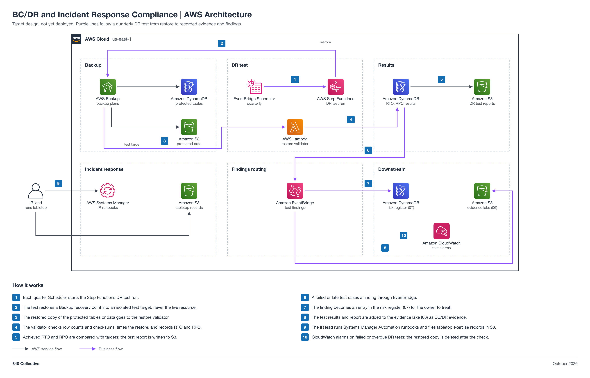

# BC/DR and Incident Response Compliance (non-engineering)

You work in Jira. Your epic: [GRC-14](https://340collective.atlassian.net/browse/GRC-14). This page is reference.

| Field | Value |
| --- | --- |
| Project | 13 BC/DR and Incident Response Compliance |
| Your role | Jason (Internal Auditor), partner: requirements, inputs, acceptance, operation, and reporting |
| Your partner | Rasheed (ISSE / Engineer) |
| Reviewer or validator | Faris accepts your Handoff 1 requirements. Your acceptance test is a pass or findings record, not an approval. Adam validates the build and Faris gives final approval. |
| Phase | Phase 1, 2 points (M) |
| Week | Week 1, Oct 19 to 25, 2026 |
| Jira epic | [GRC-14](https://340collective.atlassian.net/browse/GRC-14) |
| Mirrored folder | [engineering/Rasheed-13-BCDR-IR](../../engineering/Rasheed-13-BCDR-IR/README.md) |
| Lab guide | [LAB-STEPS.md](LAB-STEPS.md) for this folder, and the general guide [shared/labs/README.md](../../shared/labs/README.md) |

Your part: You own the IR plan, the tabletop, and the BC/DR test record. Work with Rasheed. Give him the requirements and RTO and RPO targets by Handoff 1, then run the acceptance test.

Lab steps summary

Full steps: [LAB-STEPS.md](LAB-STEPS.md). Mirror: [the other track's lab steps](../../engineering/Rasheed-13-BCDR-IR/LAB-STEPS.md).

- Define requirements: 3 steps
- Hand over inputs: 1 step
- Accept the build: 2 steps
- Operate it: 3 steps
- Assess or report: 2 steps

Handoffs

- Handoff 1: IR plan requirements, tabletop scenario, and RTO and RPO targets, Jason to Rasheed (Jira Task, created by Jason)
- Handoff 2: restore test and IR runbook build ready for acceptance testing, Rasheed to Jason (Jira Task, created by Rasheed)
- Handoff 3: tabletop summary and BC/DR test record, Jason to Faris (Jira Task, created by Jason)

Jira

- Epic: [GRC-14](https://340collective.atlassian.net/browse/GRC-14).
- Each numbered handoff is a Jira Task linked to the epic, created by the person who sends it.
- You record requirements, acceptance, and reports on the Tasks. You do not open or review pull requests; engineers keep this page current.
- Jira path 2: project events reach Jira through an EventBridge rule to the Jira REST API (an API destination) or a Jira Automation incoming webhook.

Cost

Your side costs nothing. The build's cost is in the engineering README.

AWS Backup storage and restores, and the temporary restored copy; keep restores small and delete them at the end of each test.

The program cap is 10 dollars a month for the whole account, with budget alerts at 1, 5, and 10 dollars.

Teardown

- Rasheed tears the build down after acceptance and approval.
- Confirm on the Jira Task that the teardown evidence is recorded.

Frameworks covered

SOC 2 A1.2, A1.3, CC7.4, and CC7.5; ISO 27001:2022 A.5.24 to A.5.30; NIST CSF 2.0 RS and RC.

## About the project

Proof that backups restore and that incident response is practiced: an IR plan, a tabletop, and a BC/DR test record with RTO and RPO. It supports SOC 2 A1.2, A1.3, CC7.4, and CC7.5; ISO 27001:2022 A.5.24 to A.5.30; and NIST CSF 2.0 RS and RC.

Status: target design, not yet deployed.

## Files

| File | What it is |
| --- | --- |
| [LAB-STEPS.md](LAB-STEPS.md) | Your lab steps: define requirements, hand over inputs, accept the build, operate it, assess or report |
| [Engineering README](../../engineering/Rasheed-13-BCDR-IR/README.md) | The build view: design, moving parts, and regenerate commands |
| [BCDR-IR-Architecture.md](../../engineering/Rasheed-13-BCDR-IR/BCDR-IR-Architecture.md) | Architecture doc |
| [Engineering lab steps](../../engineering/Rasheed-13-BCDR-IR/LAB-STEPS.md) | Rasheed's lab steps, with the same handoffs as yours |
